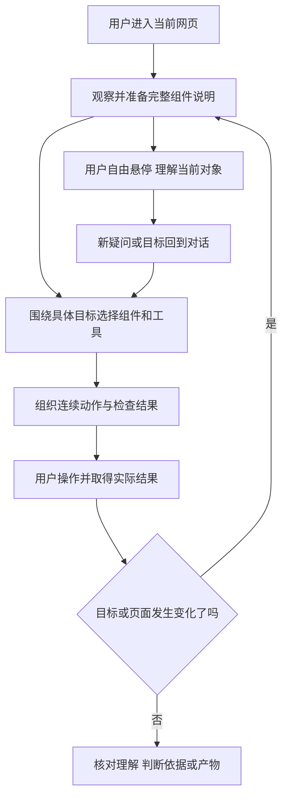

# PRODUCT

路径切换入口位于卡片区域左上角、靠左对齐；展开后为列表，每个路径条目显示路径名称和注释内容。入口与列表沿用卡片的深色磨砂主题，不使用白色面板；选择后收缩并保留路径说明。

组件标注的知识目标与检查方法见 [标注写作方法](annotation-writing.md)：读完能解释数字或行为怎样形成、变化意味着什么，或为什么需要查看另一项信息。定义与操作服务这个目标，不以篇幅和覆盖数量代替知识增量。

路径呈现规则：选定高价值路径后，同时显示该路径的全部标注，并按理解或操作顺序编号。路径切换窗主要提供选择和切换能力，用完收缩为可找回的入口；收缩不撤下路径标注。退出路径后恢复普通悬停说明。pump.fun 三组件路径已实现，证据见 [Task 11](../.TASK/11-high-value-path.md)。

本文件是产品总定义权威源，保存 Karl 已确认的产品存在性判断、产品定位、核心对象、最终成立状态、跨模块规则和模块索引。一个用户能力模块的一份 PRD 放在同目录，并由本文件维护入口；模块内尚未稳定的问题、候选方向与当前缺口保留在该 PRD 的当前交付区。

## 1. 产品存在性与用户现实

用户通常只有一个待实现的需求，或几个参考网址，还不知道该使用哪些工具、怎样从当前状态走到结果。即使进入 Semrush 等复杂 Web 工具，也可能不知道目标应分成哪些阶段、当前该做哪一步、要使用哪些组件，以及操作后的结果意味着什么。逐项介绍界面无法替用户想清完成路径，预先写好的教程又无法随新的问题、操作和目标变化继续调整。

本产品让 Karl 在 Codex 中从需求开始和 AI 一起完成事情：AI 编排工具、调查路径、具体步骤和产物交接。在内置浏览器为网页组件完整准备说明，平时保留原网页，悬停时显示对应知识；需要达成目标时，用浮动教程把组件串成连续动作。对话继续负责深入追问、跨工具判断和随实际结果调整路径。

## 2. 产品定义

- 产品名：`51-page-guide-agent`
- 一句话定义：让 Codex 理解你的目标，编排工具、调查路径和步骤，在对话中带你取得并串联各工具的结果，直到完成目标。
- 核心价值：全量组件说明帮助用户就地理解页面，高价值路径把相关组件和工具串成能得到具体成果的行动顺序；在对话中讲清理由、交接结果，并根据真实发现调整路径。
- 用户角色：当前阶段为 Karl 本人；面向所有需要使用复杂 Web 工具但不熟悉其界面的用户。
- 不做事项：独立插件侧栏、任务卡列表或另一个知识阅读页；预置网站教程库；云端账号与多端同步；通用爬虫。网页内的浮动教程属于本次明确增加的帮助能力。产品默认由用户操作网页，标注授权不包含代点击、提交或业务写入。

## 2.1 为什么转向全量标注与高价值路径

这次调整回应两种同时存在的需要：用户看见一个组件时，希望理解它；希望完成一件事时，需要知道哪些信息值得看、为什么按这个顺序看，以及怎样核对结果。只围绕当前流程准备少量标注，会把第一种需要限制在预先安排的步骤里。全量说明与目标路径分别承担这两种需要，再共享同一份组件知识。

### 全量标注：让疑问可以随观察发生

用户的注意力不会总按教程顺序移动。在 pump.fun 上，他可能先看到市值，再注意到某个钱包的供应量占比，最后想了解交易量。这些问题都有价值，却未必属于同一条操作流程。全量标注让用户自己决定看哪里，不必先选择目标或等教程走到那个组件。

完成操作也不等于理解页面。“点击价格与市值切换按钮”说明了动作，却没有解释为什么市值增长不代表同额资金进入。组件说明需要补上定义、形成机制和可使用的区别，使用户离开教程后仍能理解页面，并逐渐独立判断。具体写作标准与完整案例见 [标注写作方法](annotation-writing.md)。

全量指当前实际页面状态中的有意义组件都有对应说明，不要求一次把所有解释展示出来。默认保留原网页，悬停才显示，使覆盖范围与阅读负担分开。覆盖数量不能代替知识质量；隐藏状态、加载失败和无法观察的对象继续列出缺口，重新观察后补充。

### 高价值路径：把组件知识组织成有结果的行动

全量说明解决了“这个对象是什么意思”，但用户仍可能不知道先看什么、信息怎样联系、看完能得到什么。高价值路径围绕一个具体问题选择组件，安排观察、判断、行动与检查结果；必要时把一个工具的结果交给下一工具。它的价值来自得到的理解、判断依据或产物，不来自步骤多、覆盖按钮多或把教程播放完。

例如 pump.fun 的路径可以围绕“核对代币身份，并理解估值、交易活动和钱包分布”组织：核对合约地址，区分价格与市值，核对交易量时间范围，观察钱包占比，结合流动性理解成交价格的变化。路径结束时，用户应能说清正在看哪个代币、几个数字分别回答什么问题，以及还有哪些信息未知。这个学习结果无需连接钱包或提交交易；读完步骤不表示已经完成投资判断。

同一页面可以支持不同路径。只想辨认代币时，地址核对可能已经足够；想理解钱包集中程度时，则需要明确列表范围、排序和钱包与实际持有人的区别。路径长度和顺序由目标与实际发现决定，不为消耗全量标注强行串遍所有组件。

### 两者怎样共同工作

| 维度 | 全量标注 | 高价值路径 |
|---|---|---|
| 起点 | 用户注意到一个组件或产生局部疑问 | 用户希望解决一个问题或得到一项成果 |
| 组织方式 | 说明就地对应组件，可自由查看 | 根据目标选择组件和工具，安排依赖与顺序 |
| 主要结果 | 理解对象含义、机制及必要区别 | 串联信息，得到可核对的理解、判断依据或产物 |
| 与用户的关系 | 用户决定看哪里、解释多少 | 用户可调整目标、跳步、追问；实际结果决定后续 |
| 质量检查 | 说明是否准确、对应对象并有知识增量 | 目标是否值得完成、步骤是否必要、结果是否可核对 |

组件知识是可复用的解释，路径是在当前目标下对知识和动作的组织。选定路径同时显示全部相关标注与顺序编号，使用户能先浏览全貌，再顺序阅读或来回比较；路径切换窗用完收缩，对话继续承担深入追问、跨工具调整和结果判断。

### 路径价值与呈现要求

卡片保留标题与正文，整张卡片可点击定位组件，支持Enter与空格；移除底部对应编号提示和定位按钮。组件或编号区域被底部卡片遮挡时，先隐藏编号与连线，滚动露出后再显示，避免误指向卡片。

路径说明放在底部单行横向排列，数量多时横向滚动；组件旁编号用无箭头连线连接对应说明。页面上下滚动可移开遮挡，说明区滚动时同步更新连线，视口外对象不保留错误连接。具体实现和真实六条滚动检查见 Task 11。

- **单条标注增加理解，整条路径增加关系。** 单条说明准确且有知识增量，串联后应能解释独立看各项时不容易理解的现象。例如市值、交易量与流动性共同解释“估值和成交额很高，为什么一笔大额卖出仍可能影响价格”。
- **全部显示指当前路径，不是整页所有说明。** 全量准备组件知识；选择一条路径后，同时展示它需要的全部标注。编号表达有理由的理解或操作顺序，允许来回比较，不强制逐步点击。
- **说明和编号对应真实对象。** 标注贴近组件、顺序清楚，不遮住要观察的数据；滚动后仍能辨认对象与说明的对应。具体布局尚未实现与验证。
- **切换窗保持低存在感。** 主要提供路径选择和切换，选择完成后收缩，保留容易找回的入口。说明在网页上承担引导，切换窗不重复展示全部解释。收缩窗口与退出路径是不同动作，前者保留路径标注，后者撤下并恢复悬停模式。

以上是 Karl 已明确的体验要求；三组件路径同时展示与选择后收缩已通过真实扩展检查，当前只提供一条路径与普通浏览切换，不代表多路径库已实现。证据与视口限制见 Task 11。

### 怎样判断一条路径值得组织

以下是本次分析形成的工作检查办法，后续结合实际使用结果检验，不代表所有现有教程都已通过。

1. **结果具体且对用户有用。** 能说明走完后会理解什么、排除什么混淆，或得到什么材料。例如“区分市值和流动性”比“熟悉这页所有按钮”更具体。
2. **串联有必要。** 每一步的观察或结果服务后续判断；若一个组件说明就能回答问题，直接解释，不扩成教程。
3. **顺序有理由。** 核对代币身份后再比较数据，确认时间范围后再比较交易活动。能够说明交换顺序会产生什么混淆；没有依赖的环节允许调整。
4. **完成能够核对。** 检查真实网页结果、用户得到的材料或能解释的区别，不以“下一步”点击次数判定成功。预期与实际不一致时调整路径。
5. **范围与投入合适。** 用必要步骤取得有限成果，不擅自增加付费工具、账号要求或业务写入；进一步探索由用户目标和实际发现决定。

这次方向切换保留了按目标编排工具的能力，同时让组件知识可以脱离某一条流程独立使用。后续分别检验“局部疑问是否被解释清楚”和“路径是否带来具体成果”，避免用其中一项通过代替另一项成立。

## 3. 产品原则

- **对话是唯一使用入口**：提问、任务发现、深入学习、改变目标、继续和结束都在 Codex 对话里完成；用户无需先建立任务或选择教程。
- **先理解需求，再选择工具**：需求或参考网址即可开始。网址可以是效果参考或候选工具，不能默认它就是选定方案；工具依据目标所需能力选择，必要时组合网站、连接器、代码等，不为标注强行把所有需求变成网页操作。
- **只有大概兴趣也能开始**：AI 主动提出可调整的探索起点、阶段产物与成功标准，让用户经过一次具体体验再决定方向；市场、领域或策略等问题不作为开始前必须答完的问卷。必要的安全与操作授权仍在对应动作前核对。
- **编排工具完成目标**：工具推荐必须连同调查路径、具体步骤、产物交接和完成判断一起说明。路径可以跨网站、软件或代码，所得结果进入同一目标的后续判断；无需为了工具数量增加费用。标注移除后，思考、规划与对话仍应能指导工作。
- **按目标规划，不按界面顺序讲解**：先明确最终结果，再分解阶段、环节和当前步骤，说明理由、依赖与完成条件；随后对应到需要查看或操作的真实组件。默认不从“界面有什么东西”开始，用户明确探索页面或只问局部问题时按请求回答。
- **完整准备组件说明**：覆盖当前页面各个有意义的组件，包括导航、控件、指标、表格和视口外内容。同类重复组件可以共享解释；隐藏面板和加载后新增内容需要重新观察，明确列出未覆盖部分。
- **说明有知识增量**：采用 Apple 技术支持式文字，写清对象含义、具体动作、预期结果、必要条件和容易混淆的区别。说明不能只是复述按钮名称，也不能补造未经核对的计算口径。
- **默认保留原网页**：不常驻编号、连接线、边框、底色或遮罩，只有鼠标悬停到组件时显示对应说明。网页原有点击、输入和提示继续可用。
- **高价值路径串联目标**：同时显示当前路径全部标注及顺序编号，路径切换窗选择后收缩，保留键盘可访问的入口。路径包含具体目标、必要动作和结果核对；展示完不表示业务已完成，不替用户操作网页。
- **随操作重新观察**：AI 持续参与会话。页面跳转、用户改变选项或提出新问题后，重新观察，再决定下一次解释和标注，不依赖预先固定的步骤序列。
- **不限网站名单**：支持范围由当前浏览器实际可观察、可注入的页面决定，不以预置名单限制，也不承诺浏览器无法访问的页面。
- **现场验证与用户控制**：标注先核对页面和真实元素，定位失败就说明失败；用户亲自操作网页，随时可要求更新或清理标注。
- **本地保存服务于接续**：保存值得复用的说明、已验证定位和必要进展；重新使用时先检查当前页面。保存不是每次提问的前置条件，也不建立独立教程消费入口。
- **Skill 独立演进**：页面理解与任务指引方法沉淀为独立 Skill，不与某个模型或某个网站绑定。

## 4. 愿景与最终体验

### 4.1 愿景

让人在只有需求、尚不知道工具和操作路径时，也可以和 AI 一起把事情做完。用户在 Codex 中说出希望得到的结果或提供参考网址，AI 从最终产物反推问题，编排工具与完成路径，结合真实网页讲解每一步为什么做、怎样选择和怎样检查，并将各工具结果用于后续判断。用户在完成事情的过程中理解工具，遇到新问题时可以随时追问。

产品围绕 Codex 对话、内置浏览器、悬停组件说明、浮动教程和用户操作共同形成体验。AI 结合真实页面准备组件知识并组织目标步骤，插件负责定位、显示和反馈。完整追问、跨工具推理、Mermaid 和图片仍可在对话中展开，不另建独立知识阅读页。

### 4.2 最终使用体验

下面描述产品最终应达到的使用过程，供后续实现与验收对照。

1. **从需求、兴趣或参考网址开始。** 目标已明确时，AI 从最终产物编排工具与具体步骤；Karl 只有“想找 SEO 新词”这类大概方向时，AI 先提出可调整的教学起点，安排一次能走完的探索，说明阶段成果和成功标准。Karl 看过实际问题、工具结果和制作条件后，再判断想深入什么，不需要先选定市场、领域或完整商业模式。
2. **进入当前步骤需要的网站，必要时由 Karl 登录。** 整体方案明确后，AI 在 Codex 内置浏览器进入或复用目标页面。需要账号时说明原因，请 Karl 在该标签页自行登录；完成后重新观察页面与权限。已有目标网站和登录状态时直接接续，不重复选择工具或登录。
3. **准备整页帮助，再组织高价值路径。** AI 核对整页组件，准备有知识增量与行家感的说明；Karl 悬停任一已覆盖组件即可阅读。选定路径后全部相关标注同时显示并顺序编号，切换窗用完收缩。Karl 亲自操作后，AI 观察实际结果，将本步产物交给后续工具并调整路径；不因展示全部标注就宣告目标完成。
4. **随时追问、比较或改变目标。** Karl 可以问“这两个选项有什么区别”，也可以转去解决另一个问题。AI 在同一段对话里调整解释深度，按需要使用 Mermaid 或图像生成等工具，并替换或撤下不再适用的页面标注。
5. **看到实际结果，再结束帮助。** Karl 与 AI 对照网页上的实际结果，判断是否解决了疑问或完成了目标。Karl 可以通过对话要求清理标注或结束；完成与否由实际结果判断。
6. **有用的成果留下，下一次继续。** 值得复用的说明、已验证定位与必要进展可在本地保存。再次使用时，AI 先检查当前页面，再接着帮助；保存的内容服务于对话接续。

上述过程包含两条路径：“随时悬停组件理解当前页面”和“通过浮动教程连续操作达成目标”。原有需求理解、跨工具编排和对话调整继续支持第二条路径。局部问题直接回答；组件呈现通过不代表业务目标已完成。

### 4.3 用找 SEO 新词、准备建站理解最终体验

Karl 可以只说“我要找 SEO 新词，准备建站”，不知道市场、领域或新词含义。AI 先主动设计有限探索，例如暂用阳台种香草与美国英语作可调整起点，用一个候选连接词表、搜索结果、时间变化和页面判断。阶段成果是可追溯记录、页面设想或放下理由，以及更具体的下一问题；看到制作条件后再讨论兴趣与投入，看到趋势后再讨论是否更关注近期增长。

一个案例可以使用 Semrush、Google 搜索和 Trends：候选携来源送到后续工具，发现有价值的域名再反查，需要建站准备时才扩展五条路径与页面计划。查询前标输入框与市场设置，结果后换成候选行的词和指标；进入下一站重新定位，对话按当前编号解释。数量按目标决定，不为满足工具或步骤配额扩大探索。

完整协作见 [SEO 探索示例](</Users/zhouqi/.codex/skills/WEBTASK/WEBTASK01-理解需求并选择工具/references/seo-site-opportunity-walkthrough.md>)。另一个案例是 [MEME 纸面探索](</Users/zhouqi/.codex/skills/WEBTASK/WEBTASK01-理解需求并选择工具/references/meme-pvp-exploration.md>)：连接样本发现、地址核对、只读报价与退出估算，帮助 Karl 选择下一兴趣，演练不产生货币交易。两个案例都展示判断、话术与具体动作，文稿认可不代表 SEO 或交易业务已验收。

### 4.4 当前实现与待验证部分

产品由 Codex 对话与当前工具、内置浏览器、无独立界面的标注插件、必要通信和本地保存组成。0.1.0 的兼容证据见 [Task 06](../.TASK/06-extension-development-tools.md)。2026-10-02 已实现 MCP 参数调用、结果回传和开发自动更新；0.2.0 实际扩展通过 SDK 批量标注、更新、清理、正常操作与自动更新检查，并在官方文档网页高亮后清理。证据见 [Task 07](../.TASK/07-mcp-page-annotations.md)。当前对话原生 MCP 工具发现、复杂业务网页多轮帮助与本地复用仍需验收。

## 5. 核心对象

- **当前对话与网页**：用户提出问题、操作和获得帮助的中心；问题不必先成为完整任务。
- **页面标注**：对话中一次指示在真实元素上的呈现，可随新问题创建、替换和撤下。页面身份、目标定位、对象名称、编号与执行结果必须能对应当前网页和对话。
- **本地复用资料**：按目标项目已有位置保留解释、定位和必要进展，帮助后续对话接续。旧 task.md、guide.json 与目录索引是现有原型格式，不决定新产品必须如何使用。

完整对象关系见模块 PRD：[模块规格](modules/page-guide-agent.md)。

## 6. 页面与交互规则

- 组件说明在悬停时出现，默认没有编号、连接线、目标框或底色。说明采用具体任务语言，并解释含义、动作、结果及必要区别。
- 路径内标注同时显示并顺序编号，切换窗用完收缩；收缩保留路径标注，退出路径才恢复普通悬停。支持键盘访问路径切换能力，不自动执行业务动作。三组件实现与限制见 Task 11。
- 对话与教程共同说明目标和检查结果；深入追问及跨工具调整仍在对话里完成。
- 标注必须指向当前页面上的真实元素；无法确认时把失败返回对话，不错误指向。页面变化后更新或撤下旧标注。
- 完整覆盖针对当前实际页面状态；页面跳转、标签切换或新增组件后重新观察并更新。不存在、不可访问和无法说明的对象列为缺口，不能把自动扫描数量当成全量覆盖证明。
- 用户的提问与实际操作决定接下来做什么，可以改变目标、顺序和解释深度；不把按钮点击或教程播放完毕视为任务成功。
- 用户随时可以通过对话要求标注、替换、清理或结束；网页原有操作仍然可用。

## 7. 验收标准

当前验收标准由模块 PRD 的“当前产品验收”持有。历史原型的七项标准及证据保留在同一 PRD 的历史区，不作为新体验已经成立的证明。

## 8. 修订记录

- 2026-10-12：Karl 改为整页组件说明、有知识增量、Apple 技术支持式文字、默认原页且仅悬停显示，并增加网页内可访问的浮动连续教程；替代此前常驻名称与解释只在对话的限制。实现和真实内置浏览器检查见 Task 09。

- 2026-10-02 最新呈现：Karl 改回对象旁编号徽章＋无箭头连接线＋名称标注，名称和编号常驻，仍不影响原网页输入；每项通过 MCP color 自定义颜色，可组合用于分类。实现与真实检查见 Task 08。

- 2026-09-02：产品级事实首次回填；需求初版在对话中收敛，关键方案保留原型验证边界。
- 2026-09-03：第一阶段原型五项验收中四项取得真实证据（80%）；“任务文件为主对象”由候选方案晋升为第一阶段实现基准。
- 2026-09-03：第一阶段验收全部通过（含 EV2 人工确认）；插件形态确定为 Chrome Side Panel，任务目录化（一任务一文件夹 + 索引），播放改为用户手动推进；新增第二阶段需求 R16（Step+Lesson 知识体系）。CDP 连接与持久化格式的原型结论已写入 PRD。
- 2026-10-01：Karl 确认以 Codex 对话、内置浏览器、用户操作和即时标注为主要体验；插件独立前端退出产品方向，完整知识与内容回到对话。旧侧栏、播放器与 Lesson 保留为历史实现，代码尚未迁移。
- 2026-10-02：Karl 暂定网页标注只保留对象名称与编号，不增加复杂度；随后确认编号常驻、hover 显示名称，输入框保持正常点击和输入，详细解读按编号留在对话，并授权实施。marker 已实现，真实扩展输入与 Semrush 悬停检查见 [Task 08](../.TASK/08-expandable-annotation-details.md)；点击展开详情方案暂不实施。
- 2026-10-02 后续调整：Karl 指出 hover 会与网站自身交互冲突，改为编号与对象名称直接常驻显示，替代上一版 hover 呈现；主题色背景、放大后的字号和正常输入要求继续有效。

- 2026-10-02 目标规划调整：Karl 明确两条路径，从需求或参考判断工具，再进入内置浏览器，必要时自行登录，围绕目标分解阶段与操作并持续对话。标注是辅助，需求理解、工具判断、规划和讲解是主要工作；方法维护与待验收条件见 [Task 04](../.TASK/04-conversation-driven-annotations.md)。
- 2026-10-02 编排重点修正：Karl 指出核心是编排工具完成目标，要求通过 SEO 找词建站场景判断技能质量。工具分工、调查路径、具体步骤和产物交接成为当前方案与执行要求；贯穿案例展示做法，实际 SEO 结果仍待真实任务验收。
