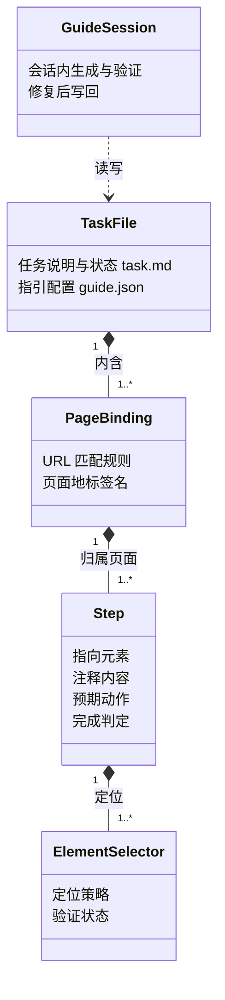
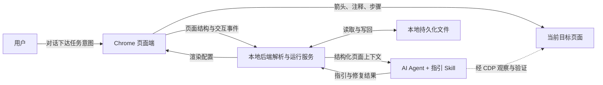
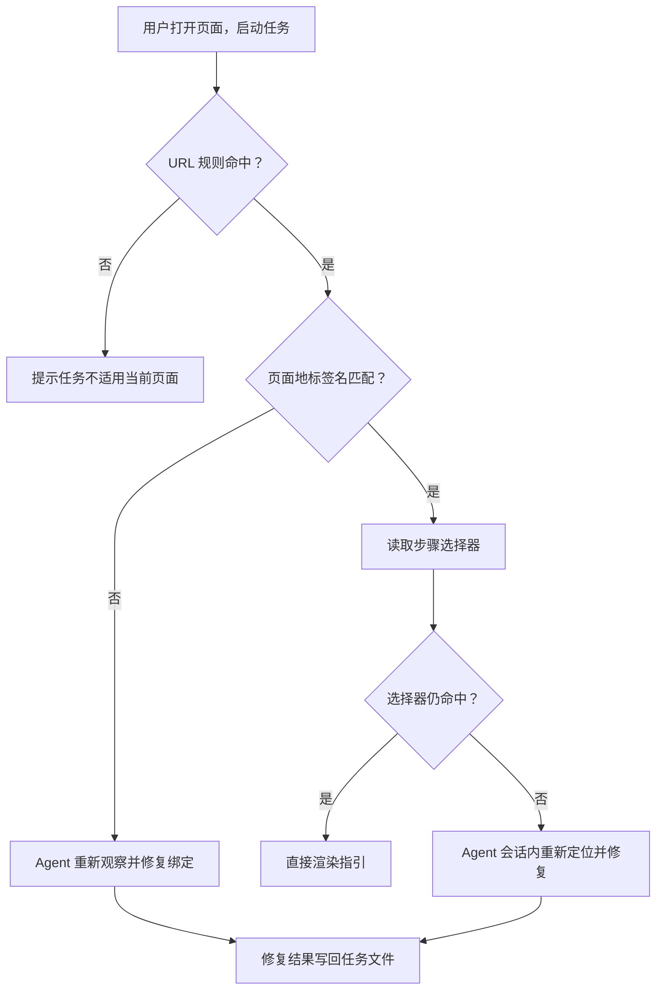

# 页面指引 Agent PRD

> 本 PRD 是核心能力模块的权威与恢复入口。产品以 Codex 多轮对话驱动网页帮助，插件只提供标注与反馈。2026-10-02 已授权并实现 MCP 与开发更新，真实验收在 Task 07；播放器和 Lesson 是历史原型。

## 当前已确认的体验与职责

Karl 在 Codex 内置浏览器中打开网页，直接在对话中问“这个选项是什么意思”“帮我比较这两个设置”或“我们一起完成这件事”。AI 观察当前页面，在对话中解释，需要指给 Karl 看时调用标注工具。Karl 操作后，AI 重新观察结果；新的疑问、不同选择或目标变化都可以改变接下来的帮助。局部提问不必先整理成完整任务。

插件不提供独立侧栏、任务列表、播放按钮、知识卡或内容预览页。它预先定义定位、标注、更新、撤下与反馈能力；标哪里、写什么、何时改变，由当前对话决定。用户操作网页，AI 提供帮助；标注权限不包含自动点击、提交、购买、发送或其他业务写入。

### 完整解释怎样出现

概念解释、参数比较、例子和深入追问在 Codex 对话里完成，需要时使用当前可用的 Mermaid、图片生成或其他工具。网页标注目前暂定编号常驻、hover 显示对象名称；例如平时显示④，鼠标移到对象时显示“被引用页面”，对话以④解释。标注不拦截鼠标与键盘，标记输入框后仍能正常点击和输入。标注不增加解释段落、点击展开、悬停详细解释或“更多”入口，也不另建 Lesson 阅读系统。用户需要多少解释，由当下问题决定，不要求一轮生成全部内容。

例如 Karl 问“这两个选项有什么区别”，AI 在对话里讲清差别，同时在页面上标出两个选项；Karl 打开第二个选项后，AI 观察新内容，替换标注并继续解释。Karl 改问另一个区域时，撤下不再适用的标注；他说“标记关了”时，清理当前标注并确认结果。这个场景是已确认的目标体验，尚非运行证据。

### 各部分负责什么

| 部分 | 当前职责 | 尚未成立的事实 |
|---|---|---|
| Codex 对话与 Skill | 理解问题、观察页面、解释、调用标注、根据结果继续 | 方法已更新；当前会话原生工具发现、复杂网页完整多轮使用尚未验证 |
| 内置浏览器 | 呈现真实网页，让 Karl 亲自操作，并提供实际可用的观察通道 | 实际测试页及官方文档页已验证；复杂业务任务仍需验收 |
| 无独立界面的插件 | 接收 MCP 转发，核对页面、元素并绘制、更新、撤下 | 0.2.0 已实际加载，无侧栏；批量、更新、清理、布局与开发更新通过检查 |
| 必要通信与本地资料 | 本机 stdio、HTTP 和 WebSocket；保存值得复用的本地资料 | SDK 实际通信与会话分组通过；持久复用仍需验收 |

浏览器不兼容时查明实际安装、注入和通信条件，不用独立 Chrome 播放器替代。当前六项工具与参数见 [MCP 标注协议](../protocols/mcp-annotations.md)，权威 schema 是 `src/contract.mjs`；是否真实可用看任务证据。

### 当前需求

保留 R1–R16 编号及原文供追溯；它们在后文历史区。当前开发按下面的 R17–R24 判断，不把旧播放器的格式和界面当作前置条件。

| 编号 | 已确认要求 | 检查时应看到什么 |
|---|---|---|
| R17 | Codex 对话是唯一产品使用入口；允许局部问题及多轮任务 | 未创建教程卡也能问懂或开始一件事 |
| R18 | 主要使用环境为 Codex 与内置浏览器 | 实际连接指定内置标签页，保留用户当前页面状态 |
| R19 | 插件只提供预先定义的标注工具与中间层能力，无独立产品前端 | 用户无需打开侧栏、选择任务或点击播放 |
| R20 | 完整内容在对话中呈现；网页标注暂定编号常驻、hover 显示对象名称，不增加复杂度 | 平时显示④，hover 显示名称；输入框仍能正常点击和输入；对话以④解释，无网页详情入口 |
| R21 | 按问题创建、更新、替换和撤下标注，定位先验证 | 标注对应当前页面和真实目标；新问题可替换旧标注 |
| R22 | 用户操作后重新观察，标注结果与必要反馈回到当前对话 | 新页面、失败和目标改变得到相应解释，不按固定序列虚假推进 |
| R23 | 用户可在对话中要求清理或结束，保留正常网页操作 | 标注撤下成功有反馈，网页仍可操作 |
| R24 | 本地保存服务于后续对话接续与复用，使用前重新检查页面 | 不强制保存每个问题；复用时失效定位会被修复或说明失败 |

### 当前产品验收

核心结果标准集中在 [EVAL](../../EVAL.md)。下面保留详细检查场景与条件；实际验证结果在原 Task 和本模块当前交付区，不把“要求已确认”当成实现已通过。

1. 在一个未预配置的真实复杂页面上，从 Codex 对话直接提出局部问题；无需任务卡，解释能准确对应页面对象。
2. 同一轮需要指出两个选项时，能在真实页面同时标出正确对象。只有选择器可解析或文字回答正确，不足以算标注成功。
3. Karl 亲自操作后，AI 观察新页面再继续；中途改变目标或提问顺序时，更新帮助与标注，不要求重建或重播完整教程。
4. 网页编号常驻，hover 对应对象时显示名称，移开后名称隐藏；输入框仍能点击和输入。对话用相同编号提供完整解释、例子、图表和图片；不增加点击展开、悬停详细解释或更多入口，插件没有独立内容阅读入口。工具不可用时如实说明，不能展示虚构产物。
5. 错页、目标不存在或定位不唯一时，不显示错误指向；把具体失败返回当前对话，能修复就验证后重试。
6. Karl 在对话中要求“撤下这些标注”，当前页面实际清理，并返回结果；滚动、跳转或页面更新后不会留下误导标记。
7. 保存过有用资料后，下一次对话检查页面和已完成事项再接续；未验证精确步骤恢复时，不声称已从中断处继续。

### 接下来怎样实现与验证

安装与真实 MCP 通信已通过 Task 07 检查。下一项先确认自然开始的 Codex 会话发现原生工具，再选定一个实际使用的复杂页面，把“提问 → 标注 → 用户操作 → 再观察 → 更新或清理”走完整，随后处理多页面与本地复用。每段报告浏览器、版本、页面、动作与未覆盖项。

早期定义与安装调查见 Task 04、06。2026-10-02 Karl 授权“创建计划，然后实施”，当前代码、首次重载与真实验证都在 [Task 07](../../.TASK/07-mcp-page-annotations.md)。TEAM 控制目录由 Leader 接续，main 不代改。

2026-10-02 的 Semrush 教学明确了当前暂定的轻量呈现规则，文档与技能同步见 [Task 08](../../.TASK/08-expandable-annotation-details.md)。现有 MCP 的 text 可写入对象名称与编号，但当前渲染器仍常驻显示 text，编号常驻、hover 名称的呈现尚未实现；具体参数与渲染修改需按该要求另行设计，不能当作现有接口能力。先前点击展开方案暂不实施。

## 1. 历史原型定义与七项验收

以下 1.1–1.10 保留 2026-09 的原型要求、编号和方案，便于解释已有代码与证据。Side Panel、任务卡播放、lesson.blocks 和插件直读任务目录已被当前方向替代，不再作为新产品要求；其中页面观察、唯一定位、真实验证和敏感信息限制仍需保留。原文中“当前推荐”“第二阶段”均指当时的原型阶段。

### 1.1 用户现实与目标收益

用户（当前阶段为 Karl 本人）在使用复杂 Web 工具（典型如 Semrush 的设置与报表页面）时，经常无法理解页面上各功能的作用：不知道该填什么、先点哪里、各设置项之间是什么关系。现有解决方式是离开页面去问 AI、查官方文档或看教程；上下文断裂，且 AI 的回答无法与页面上的具体元素对应，用户仍需自己把文字答案映射回界面。

目标收益：用户不离开当前页面，通过对话让 AI 理解页面结构，并在页面上直接渲染出箭头、指针、注释和下一步指引；每次会话的学习成果沉淀为本地任务文件，同一任务重复使用时越用越准。

### 1.2 模块定义、边界与产品关系

本模块是产品 `51-page-guide-agent` 的核心能力模块，承载全部产品能力；`PRODUCT.md` 只保存跨模块摘要。

**能力边界**：

- 支持「任意网页」：只要有 CDP 协议可达的页面，AI Agent 就能观察页面并在会话内循环迭代。不做网页白名单、不做预置范围限制——这是产品级确认的设计决策，不是省略。
- 指引是「教学」不是「代做」：AI 生成并渲染指引，操作由用户自己完成。AI 可以读取页面、验证选择器、写回配置，但不替用户点击。

**不做事项**：

- 第一阶段不做 AI 自动替用户执行点击。
- 不做云端账号系统与多端同步。
- 不预置任何网站的静态指引配置库；指引配置一律由 AI 会话内生成，人工维护不是产品的长期形态。
- 不做与页面指引无关的通用爬虫或数据提取。

### 1.3 核心对象与语义



- **任务文件（Task File）**：持久化的独立文件对象，以「完成某件事」为用户心智单位。一个任务一个文件夹，内含人类可读的 `task.md` 与结构化的 `guide.json`；本地文件、可 diff、可进 Git、人和 AI 都能直接读写。
- **页面绑定（Page Binding）**：任务文件内的粗粒度匹配层——URL 匹配规则 + 页面地标签名（标题、关键标题文本、aria 结构锚点）。决定「这个页面是否属于本任务」。
- **步骤（Step）**：一步指引，含指向元素、注释、预期动作与完成判定。第一阶段只用单步注释，第二阶段引入步骤序列推进。
- **元素选择器（Element Selector）**：细粒度定位层，由 AI 在会话内生成并验证；修复后写回任务文件。
- **指引会话（Guide Session）**：AI Agent 的一次工作过程——观察、生成、验证、修复、写回。会话是生产者，不是持久对象。

**当前推荐的对象关系**：以任务文件作为主对象，网页通过页面绑定关联到任务；同一个页面可以承载多个任务。Karl 已确认必须持久化，也明确提出了“任务文件”与“网页文件”两种可能形态；任务为主、网页为绑定信息是当前推荐方案，仍需在原型中验证它是否比“网页为主对象”更容易创建、查找和恢复。

### 1.4 需求目标与阶段边界

**第一阶段——页面结构识别与静态注释指引**。目标是验证整条流水线的生死假设：CDP 观察 → AI + 指引 Skill 生成 → 选择器验证 → 页面渲染。交付物是一个复杂页面上真实可用的注释指引（箭头 + 注释），以及沉淀该页面的任务文件。

**第二阶段——任务步骤指引**。在流水线已验证的基础上引入双向回路：步骤状态机、用户交互反馈、完成判定与失败提示。交付物是可完整走完一个任务的交互式向导。

两个阶段的分界线：第一阶段数据流单向（页面 → AI → 指引）；第二阶段开始引入用户交互反馈改变指引状态。

### 1.5 需求清单

| 编号 | 需求 | 阶段 |
|---|---|---|
| R1 | 用户通过自然语言对话下达任务意图（如「教我用这个功能」） | 一 |
| R2 | Agent 通过 CDP 观察任意页面结构（DOM / Accessibility / Runtime） | 一 |
| R3 | AI 依据指引 Skill 产出结构化指引配置（选择器 + 注释 + 可选步骤） | 一 |
| R4 | 在页面上渲染指引层：箭头、高亮、注释气泡 | 一 |
| R5 | Agent 用 CDP 验证每个选择器真实命中；未命中则重新观察修正 | 一 |
| R6 | 指引成果写入本地任务文件并持久化；同任务第二次打开可直接加载 | 一 |
| R7 | 三层绑定匹配：URL 规则 → 页面地标 → 元素选择器，逐层校验 | 一 |
| R8 | 会话内修复失效绑定与选择器后，把修复结果写回任务文件（自愈） | 一 |
| R9 | 指引失效时显性显示「指引过期」状态，不沉默失效 | 一 |
| R10 | 步骤推进状态机：等待用户完成 → 检测交互 → 推进下一步 | 二 |
| R11 | 用户交互反馈回传 Agent，指引状态随真实操作变化 | 二 |
| R12 | 任务以目录承载：一任务一文件夹（guide.json），index.json 作为发现索引；Agent 增删任务只影响自己的文件夹 | 一（已在原型实现） |
| R13 | Chrome 端为 Side Panel 形态：任务列表按当前页面自动筛选，播放控制与后续知识阅读都在面板内完成 | 一（已在原型实现） |
| R14 | 播放由用户手动推进：每步等待用户点击「下一步」，不用定时器自动轮播 | 一（已在原型实现） |
| R15 | 插件直读本地任务目录（扩展「允许访问文件网址」权限），HTTP 服务只是可选备份通道；任务包的生成与维护是 Agent 的职责，插件不做任何导入入口 | 一（已在原型实现） |
| R16 | Step 知识体系（Lesson）：每个步骤可展开关联知识卡（正文、列表、要点、内嵌交互），在 Side Panel 中阅读；用户可只跟步骤快速完成，也可深入阅读，两种节奏并存 | 二 |

### 1.6 约束条件

- **不限制支持的网页范围**（产品级确认）。任意 CDP 可达页面都在能力域内；网页改版由会话内迭代消化，不转为长期人工维护。
- **本地优先**：AI Agent 与任务文件都在本地；第一阶段不依赖云端服务。
- **任务文件是人类可读的本地文件对象**：格式简单、可 diff、可进 Git，人和 AI 都能直接读写。
- **Chrome 端保持薄**：渲染层与 CDP 桥只做渲染和反馈采集，不理解页面语义、不做 AI、不维护配置内容。
- **后端解析属于产品组成**：本地后端负责接收和整理页面结构、协调 Agent 会话、管理持久化文件，并为 Chrome 页面端提供稳定接口；第一阶段可以最小实现，但不能从产品结构中删除。
- **Skill 是独立资产**：指引方法论（如何观察页面、选择定位策略、验证命中、组织注释与步骤）沉淀在 Skill 中，与模型选择解耦；模型可换，Skill 累积。
- **指引配置不预置**：第一阶段验证的重点恰恰是「AI 能否对陌生页面凭空产出正确指引」，任何人工预置都会掩盖这个假设的验证。

### 1.7 方案

**组件与数据流**：



- **Chrome 页面端**：运行在目标网页中，采集页面结构，渲染箭头、高亮、注释和步骤，并在第二阶段回传用户交互。
- **Chrome Side Panel**：插件主界面形态。任务发现、任务选择、播放控制、进度与后续 Lesson 阅读都在面板中；页面内气泡只承担「指向当前元素」的现场指示。
- **本地后端解析与运行服务**：整理页面结构、协调 Agent 会话、管理文件读写，并连接 Chrome 页面端与 AI Agent。是否把 CDP 连接放在页面端或后端，由原型验证后决定。
- **CDP 通道**：页面观察与验证的统一能力，是「不限网站名单」承诺的技术前提。
- **AI Agent + 指引 Skill**：产品决策核心。Skill 定义会话内工作法：先扫页面骨架再下钻、定位策略优先 role/aria/文本锚点、验证选择器命中、注释粒度、多步任务组织、失败表述。
- **本地持久化文件**：保存任务或网页对象、页面绑定和已验证指引。当前推荐以任务为主对象，最终文件模型待原型验证。
- **任务目录与索引**：任务以文件夹为单位持久化（每任务一个文件夹 + guide.json），目录级 index.json 承担发现索引。Agent 增删改任务只触碰自己的文件夹和索引行，插件按索引加载后按页面 URL 筛选展示。

**任务文件结构**：

```text
tasks/
  index.json                          ← 发现索引：{"tasks":[{"dir":"..."}]}
  <task-slug>/
    guide.json                        ← 结构化指引配置（AI Skill 的产出物）
    task.md                           ← 人类可读的任务说明 + 状态（后续补充）
```

**三层绑定与匹配流程**：

| 层级 | 内容 | 变化频率 |
|---|---|---|
| 页面绑定（粗） | URL 匹配规则 + 页面地标签名 | 目标网站改版才变 |
| 步骤绑定（中） | 步骤归属页面 + 推进条件 | 任务定义变化时 |
| 元素选择器（细） | 具体元素定位 | 每次会话都可能刷新 |



**分层失败语义**：URL 不命中是「任务不适用」，正常提示；地标不命中是「页面可能改版」，进入重新观察；选择器不命中是「常规迭代」，会话内修复。三层失败都不沉默——用户总能看到指引层处于什么状态。

### 1.8 主流程与中断恢复

主流程（第一阶段）：用户在目标页面唤起 Agent → 对话说明意图 → Agent 读取任务文件（有则加载，无则新建）→ CDP 观察页面 → 按规则生成指引 → 逐条验证选择器 → 注入渲染 → 用户查看注释 → 会话成果写回任务文件。

中断恢复：任务文件即恢复面。会话中断、浏览器重启或换设备（同机）后，用户重新打开同一页面并选择任务，从任务文件加载已验证配置直接渲染；文件中没有或失效的部分由 Agent 会话内重建。

### 1.9 技术架构与平台边界

- 平台：Chrome 页面端 + 本地后端解析与运行服务 + 本机 Agent 运行环境 + 本地持久化文件。这里的“后端”是本机服务，不等于云端服务。
- 依赖方向：Chrome 页面端不直接依赖具体模型；本地后端负责连接页面端、Agent 与文件；Agent 通过 Skill 产出和修复指引。
- CDP 连接归属（原型结论）：Agent 脚本经 playwright-core 以 `channel: chrome` 直连真实 Chrome 已验证可行（T1），原型阶段由 Agent 侧直接承担观察与验证；独立本地后端服务在任务规模扩大前不是必需件，任务分发当前由「本地任务目录 + 扩展直读」承担。引入独立后端的触发条件：需要跨浏览器会话协调、多端同步或服务端渲染能力时再评估。
- Skill 与实现解耦：Skill 文档独立于插件代码演进；更换底层模型不改变 Skill 内容，只改变 Skill 的执行者。
- 持久化格式（原型结论）：JSON 为主的任务文件 + 目录级索引已验证够用；task.md 人类说明文件保留为后续补充位。Git 作为版本与审计层，不是产品成立的前提。

### 1.10 可观察验收标准

**第一阶段（全部执行前属于稳定事实）**：

1. 给定一个此前未配置过的复杂页面（如 Semrush 某设置页）和一个明确任务，当用户通过对话发起指引，Agent 无需人工写任何配置，会话内产出覆盖该任务所需关键元素的指引，并在页面渲染出正确命中的箭头注释；每条选择器经 CDP 验证真实命中，具体覆盖数量由任务决定，不预设固定数字。
2. 注释内容经人工确认准确且有用（对元素作用、该填什么、与相邻项的关系），不是泛泛的控件名复述。
3. 当同一任务第二次打开，指引从任务文件直接加载渲染，无需重新生成（持久化生效）。
4. 当目标页面发生小改版，Agent 会话内重新定位失效元素，修复后写回任务文件，页面指引恢复。
5. 当 Agent 无法修复某条指引，页面显性显示「指引过期」，不显示错误指向或沉默消失。

**第二阶段**：

6. 给定一个多步任务（如「完成一次关键词调研」），用户按指引在页面上逐步完成操作，每步完成后自动推进到下一步，全程不离开页面、不求助外部文档。
7. 当用户跳过或做错某一步，指引状态如实反映（重试提示或失败说明），不虚假推进。

## 2. 当前交付

当前运行已改为 0.2.0 无独立前端的 MCP 标注扩展，开发输出保持原加载目录。真实 SDK 经本机桥接调用安装扩展，批量、更新、会话清理、动态布局、正常输入、开发自动更新和服务重连通过；官方 Chrome 文档页也完成高亮与清理。最终开发构建为 `fce576ac325ef9d7`，自动检查 11 项通过，证据和限制见 [Task 07](../../.TASK/07-mcp-page-annotations.md)。当前原生会话工具发现、复杂业务网页完整多轮体验与持久复用尚未验收。

第一阶段历史原型完成过五项验收，Side Panel、任务卡、手动下一步和任务目录直读的代码与证据保留；旧 content/background 已由新源码生成，同路径旧实现从 Git 历史追溯。历史记录见 [Task 01](../../.TASK/01-cdp-guide-prototype.md)。

旧第二阶段已有完成判定、状态机与 Lesson 实现，真实插件人工验收与 P2 收口未完成。因方向调整，不再把验收独立知识卡作为当前下一项，未验收事实仍保留在 [Task 02](../../.TASK/02-phase2-interactive-wizard.md)。t7 是剥离 chrome API 的注入与合成事件证据，不能替代完整插件验收。新 MCP 双向命令与反馈已通过真实扩展检查；连续对话动态标注与真实网站改版修复仍待验证。

官方开发 Skill 的安装、CLI 检索读取及 MCP 扩展工具发现已通过检查，证据见 [Task 06](../../.TASK/06-extension-development-tools.md)。Karl 手动加载 Page Guide Agent 0.1.0 后，真实内容脚本在内置浏览器受控 HTTP 页面通过双击入口准确绘制并撤下标注，没有注入扩展源代码或模拟 Chrome API。这是旧扩展兼容证据，R18–R23 的完整对话体验仍未验收。

## 3. 已验收目标证据

第一阶段原型验证（Task `.TASK/01-cdp-guide-prototype.md`）取得以下证据：

这里的验收标准 1–5 均指上文历史 1.10，不指当前产品验收；保留原覆盖范围，不把历史通过改写成新体验通过。

- 已证明验收标准 1（未配置页面凭空产出指引）：OpenRouter 模型页上 5/5 条注释指引经验证命中并渲染。证据：`prototype/cdp/samples/openrouter-guide-render.png`、`openrouter-guide-verify.json`。未覆盖：其他网站的适应性。
- 已证明验收标准 3（持久化生效）：指引从本地任务文件二次加载渲染 5/5 命中，零重新生成。证据：`prototype/cdp/samples/t5-reload-render.png`、`t5-reload-verify.json`。
- 已证明验收标准 4（改版自愈）：模拟改版（placeholder 与两个筛选标题改名）后命中 5→3，Agent 重新定位 2 条失效项并写回任务文件 revisionLog，恢复 5/5 命中。证据：`prototype/cdp/samples/t6-selfheal-verify.json`、`t6-selfheal-render.png`。未覆盖：真实网站改版（本次为 DOM 注入模拟）。
- 已证明验收标准 5（失效显性显示）：不可修复条目在页面右上角显示红色「指引过期」徽标，不错误指向。证据：`prototype/cdp/samples/t6-selfheal-render.png`。
- 已证明验收标准 2（注释质量）：Karl 在真实浏览器中通过 Side Panel 插件播放 OpenRouter 指引并人工确认「效果还不错」（2026-09-03），随后在确认基础上继续迭代了样式与交互。
- 阶段后补充验证（超出原验收边界的交付能力）：同页多任务选择播放（两个任务卡片按 URL 筛选）、手动下一步推进、Side Panel 形态、本地任务目录直读（`prototype/extension/`，含 sidepanel.js 与 content.js）。

**顶层对象方案结论（原型验证）**：以任务文件（task.md + guide.json）为顶层对象的原型已完整走通创建、持久化、二次恢复与自愈写回全链路，恢复成本 = 一次文件读取 + 一次页面加载；“网页为主对象”形态未做对等原型，当前无证据显示其恢复成本更低。结论：任务为主对象从候选方案晋升为第一阶段实现基准；真实多任务、多页面场景的成本复核推迟到第二阶段前。

## 4. 长期踩坑点

- **把保存格式变成使用入口，会让 AI 在生成后退场。** 旧原型以完整 guide、固定步骤与播放为中心；新方向把对话放回中心，文件只服务于接续与复用。
- **独立知识卡会重复建设对话已有的内容能力。** 当前知识与深入解释留在对话，页面标注只负责对应真实对象；不继续要求 lesson.blocks 或另一个阅读页。
- **Chrome 原型通过不能证明内置浏览器接入成立。** 必须检查真实安装、注入与通信；既不编造支持能力，也不通过改文档把 Chrome 播放器算成最终体验。
