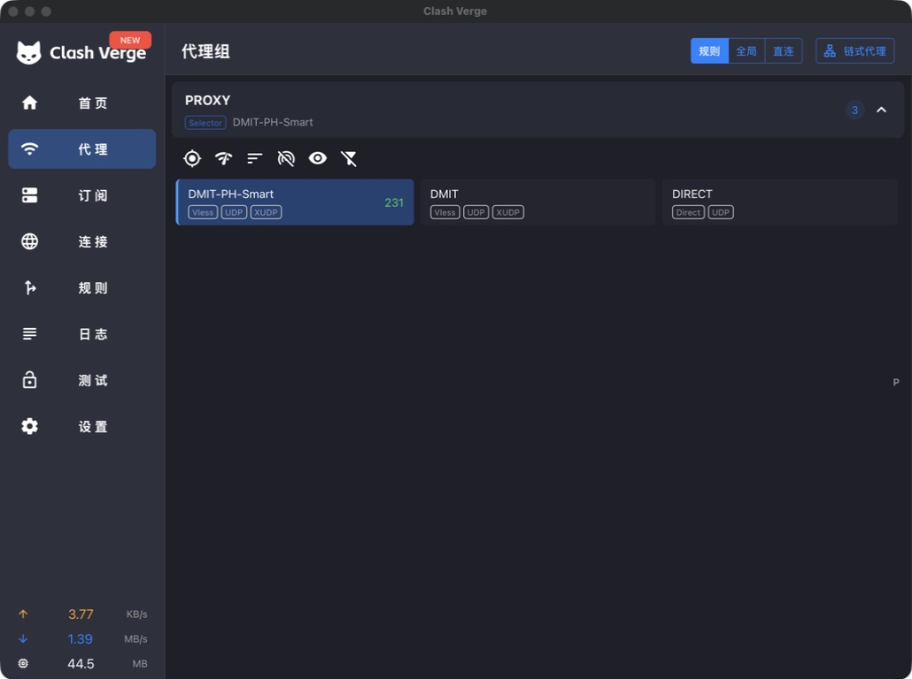
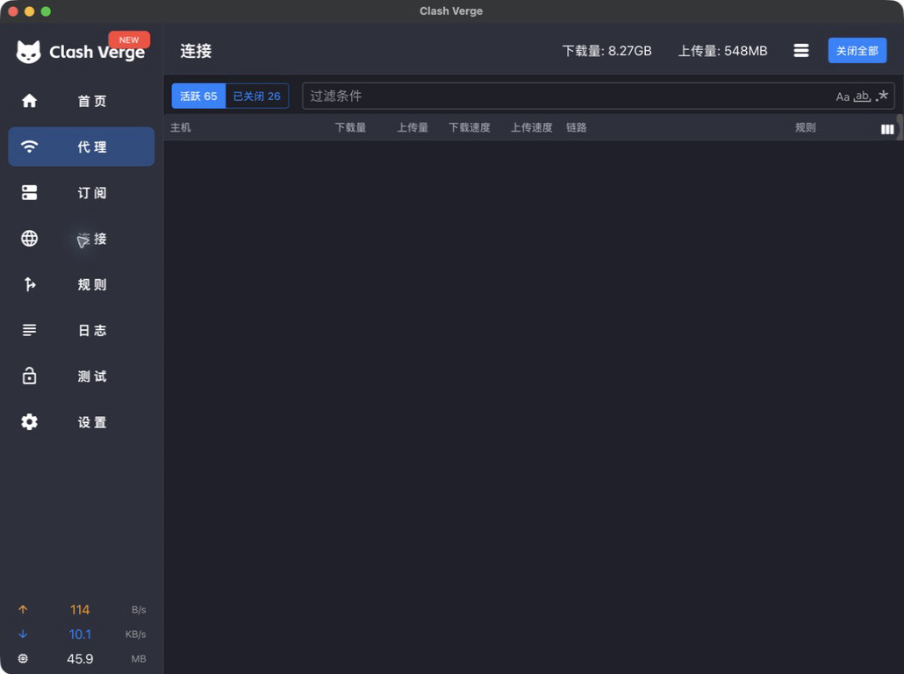
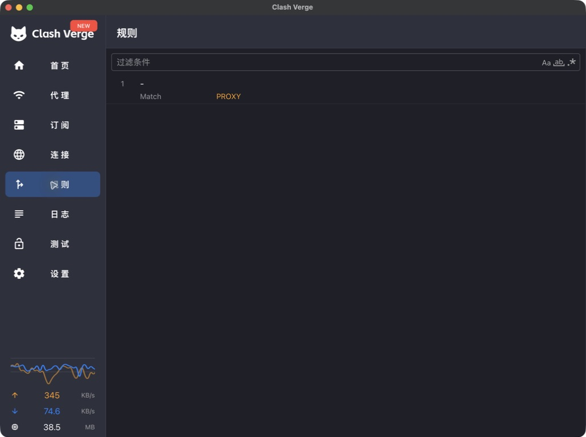
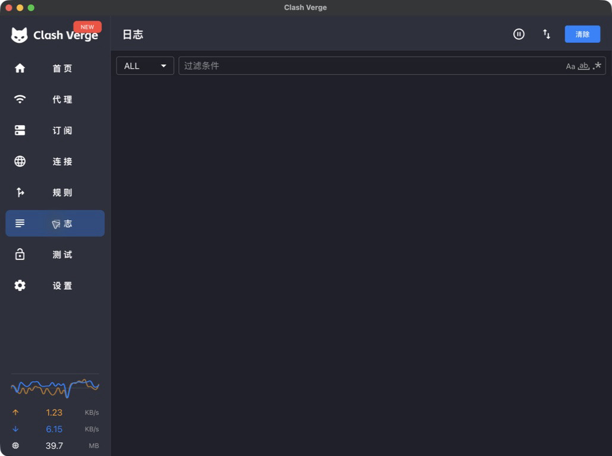
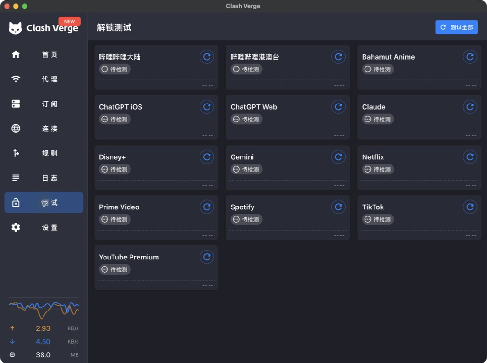
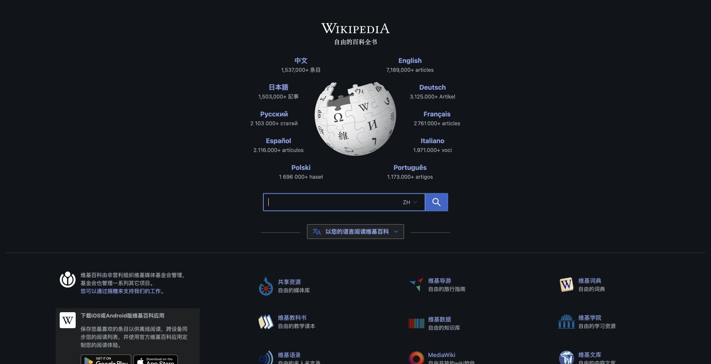

# Clash Verge：从看懂代理到排查连接

这是一份给第一次使用 Clash Verge 的读者的现场图解。你会先弄懂四个页面怎样配合，再学会判断“流量准备怎样走”“实际怎样走”，以及“出了问题该看哪里”。

## 本次观察范围

- 软件：Clash Verge 2.4.7（macOS）
- 时间：2026-09-06 14:04（Asia/Shanghai）
- 已查看：代理、连接、规则、日志、测试
- 方式：桌面 Accessibility 信息和现场截图
- 本次只做页面导航与信息查看，没有切换节点、修改配置、清除日志或启动测试

> **先保护当前网络**：代理模式、节点选择、订阅更新、配置编辑和网络测试都可能改变真实网络或产生外部请求。本教程解释这些入口，不替你执行高影响操作。

## 先建立一个简单模型

把 Clash Verge 想成一个交通调度台：

1. **模式**决定“按什么总规则处理流量”。
2. **代理组**决定“一类流量交给哪条路线”。
3. **连接**显示“已经上路的请求”。
4. **规则**解释“为什么请求被分到这条路线”。
5. **日志**按时间留下处理线索。

所以，四个页面的关系是：

`代理（计划） → 规则（理由） → 连接（结果） → 日志（时间线）`

遇到网页打不开时，先确认连接是否出现，再看链路和规则，最后用日志对时间。不要一开始就盲目切换节点。

## 代理页：看流量准备怎样走

### 你来这里要解决什么问题

你想知道当前采用哪种分流方式，或者准备在确认风险后调整模式和代理组。

### 先看模式，再看代理组

截图中的“规则”处于选中状态。可以把它理解成：后续请求先经过规则判断，再交给对应的代理组。

“全局”和“直连”改变的是这个判断方式，不只是页面标签。切换模式可能改变真实网络流量，所以本次只记录入口，没有执行切换。

### 再看当前代理组

`PROXY` 组当前显示 `DMIT-PH-Smart`，旁边还有 `DMIT` 和 `DIRECT` 等节点卡片。节点名称、协议标签和数量是界面状态；它们不能单独证明网络已经连通。

截图标注：

1. 左侧“代理”：当前看的页面身份。
2. 模式入口：规则、全局、直连和链式代理。
3. PROXY 组：一组可以接收流量的处理路线。
4. 节点卡片：当前可见的选择项；本次没有切换。

### 什么时候停下来

如果下一步会切换模式、节点或系统代理，先确认影响范围。要判断切换是否有效，应在授权后同时观察连接页和日志页。

## 连接页：看当前连接实际走了什么

### 你来这里要解决什么问题

你想确认某个网页或 App 是否产生了连接，以及连接经过了哪条链路。

连接页是“结果检查页”，不是配置页。它提供：

- **活跃 / 已关闭**：先确认目标连接是否仍然存在；
- **过滤条件**：缩小目标主机或进程范围；
- **列设置**：选择排查需要的字段；
- **链路与规则**：同时查看经过哪里、为什么这样走；
- **进程和时间**：把连接与具体 App 或网页对应起来。

### 推荐的阅读顺序

1. **先问“有没有”**：列表没有目标时，可能是请求尚未产生、连接已关闭，或过滤条件太窄。
2. **再问“经过哪里”**：把链路和规则与代理页的当前组对照。
3. **最后问“是谁产生的”**：用进程、时间和主机字段定位来源。

现场能看到 `PROXY / DMIT-PH-Smart` 和 `Match` 等字段。它们证明界面记录了这条连接；不能单独证明所有后续请求都成功。连接明细已从截图中遮盖，避免保存私人网络信息。

## 规则页：解释为什么这样分流

规则页适合在你已经看到一条连接之后使用。你要找的是：

1. 这条流量满足了什么匹配条件；
2. 规则给出了什么处理结果；
3. 连接页是否出现了相应链路。

现场看到规则条目、过滤条件和 `PROXY` 处理结果。完整规则优先级没有在本次只读范围内逐条验证，因此这里只解释页面可见关系，不外推完整配置行为。

## 日志页：把问题放回时间线上

日志不是“成功 / 失败”按钮，而是一条时间线。推荐按这个顺序：

1. **暂停**：停止滚动，先读完当前记录。
2. **筛选级别**：现场确认有 `ALL`、`DEBUG`、`INFO`、`WARN`、`ERROR` 五项。
3. **过滤文字**：缩小到目标主机、进程或时间附近。
4. **回到连接页对照**：确认日志中的目标、链路和规则是否对应同一条连接。

某一条 `INFO` 记录只证明它被记录下来，不等于请求最终成功。日志明细已从截图中遮盖。

## 测试页：知道入口，但不要误触发

现场看到“测试全部”和多个服务测试入口，状态为“待检测”。测试会产生真实网络请求，可能暴露当前网络状态，因此本次只记录入口，没有启动测试。

## 一条安全的排查流程

当某个网页或 App 似乎无法联网时：

1. 记下当前模式、代理组、目标对象和问题时间。
2. 到连接页过滤目标，确认有没有活跃或已关闭连接。
3. 有连接时查看链路和规则，再回到代理页确认是否符合当前模式。
4. 到日志页暂停、过滤并按时间对照。
5. 只有证据明确指向模式、节点或订阅问题时，才考虑改变配置；那是需要单独确认的操作。

如果仍然不确定，保留当前状态并写下“看到了什么、还缺什么”。不要用“换个节点试试”代替判断。

## Chrome 网页回归

第二条回归使用公开的 Wikipedia 首页。网页分支取得了 URL、标题、语言入口、搜索框和 ARIA 角色等结构证据，没有输入或提交内容。

两类界面的共同点是先建立用户任务和页面模型；差别在证据来源：桌面 App 可能主要依赖窗口、Accessibility 和截图，网页还可以用 DOM、ARIA 和 CDP 验证结构。

## 证据边界

- 图片位于当前目录的 `assets/`。
- 连接和日志明细已遮盖。
- 数值、节点名、连接数和状态只代表本次观察。
- 规则完整优先级、节点实际连通性和测试结果没有在本次只读观察中验证。

