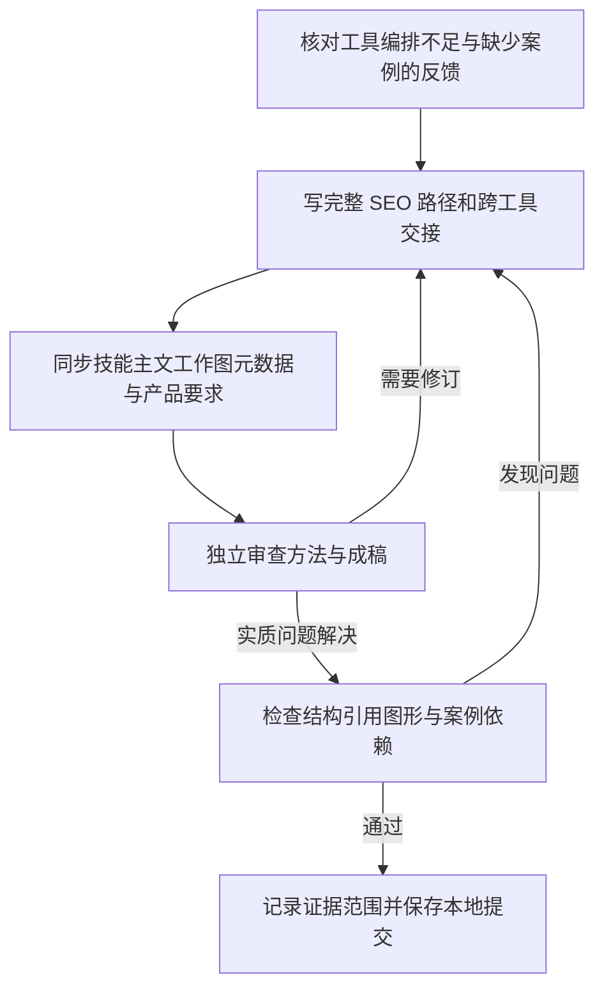
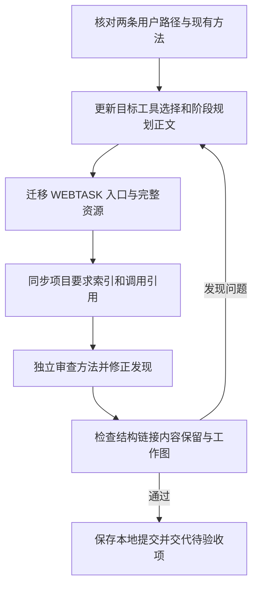

# 04 对话驱动的网页标注：文档与技能维护

## 2026-10-02 后续修正：编排工具完成目标，补充 SEO 贯穿案例

Karl 指出前一版没有把握重点：关键是编排工具完成目标，且缺少具体案例，难以判断方法是否有效。本轮沿已有授权修正两项 WEBTASK 技能与相关产品正文，不修改插件源码或业务数据，不重新迁移技能名称。

最早偏差是 WEBTASK01 在推荐工具后就结束，WEBTASK02 主要围绕一个网站展开；虽有目标与阶段，却没有说明多个工具的结果怎样接成最终产物。当前改为从最终产物反推问题，编排调查路径、工具分工、具体步骤和输入输出；执行时检查产物、交给后续工具，并依据发现调整整体方案。工具与步骤数量按目标决定。

完整案例保存在 [SEO 找词到建站准备](</Users/zhouqi/.codex/skills/WEBTASK/WEBTASK01-理解需求并选择工具/references/seo-site-opportunity-example.md>)，以假设的小空间种植题材展示三种研究工具、五条调查路径、每条七到八步。主文同时写入具体工具分工、路径交接与现场对话，不只附链接。候选词和题材标为假设，官方工具能力以 2026-10-02 资料为依据；实际账号、找词结果与建站判断尚未执行。

长期要求在 PRODUCT、模块 R25/R26、EVAL PGA-09/10 和 AGENTS 同步。完整方案与报告产出增加独立成稿审查循环，局部解释继续直接帮助；页面只显示常驻名称与编号，正常输入、权限、敏感信息及旧兼容合同保留。

本轮按下面的过程检查方法，实际 SEO 业务结果另用真实任务验收。

### 本轮检查结果

- **独立审查与复查通过。** 按 SKILL03 调度 gpt-6.1-sol 只读审查两项主文、案例、元数据、直接资源与受影响项目要求，确认已改变核心编排方法。采纳两项意见：工作图把失败分为修复当前页面、继续独立路径与调整整体方案；案例补具体待查记录，让各工具共同更新同一候选。修订后复查未发现新的实质问题。
- **结构与引用通过。** 两项技能均通过 quick_validate.py；15 份相关 Markdown 共324处本地链接没有缺失，本次 diff 格式检查通过。调用名与文件夹保持 WEBTASK01/02；两项入口已出现在当前会话技能清单，原生标注 MCP 工具发现与真实调用另按运行证据判断。
- **工作图实际渲染通过。** 隔离 headless Chrome 实际渲染两项技能、SEO 路径与本 Task 四张工作图；失败分支修订后重新渲染并查看图片。证据为[编排图](../.PROTOTYPE/validation/tool-orchestration/workflow-1.png)、[执行图](../.PROTOTYPE/validation/tool-orchestration/workflow-2.png)、[SEO 交接图](../.PROTOTYPE/validation/tool-orchestration/workflow-3.png)、[维护图](../.PROTOTYPE/validation/tool-orchestration/workflow-4.png)，同目录保留 SVG 与[渲染页](../.PROTOTYPE/validation/tool-orchestration/workflows.html)。这是文档检查，不是内置浏览器业务验收；临时浏览器已关闭，未操作用户业务页面。
- **方法检查范围。** 用完整成品逐项检查五条路径的输入、动作、交接、完成判断与受限分支，并查官方工具方法，确认案例假设与待查值清楚。未登录研究账号、读取实际报告、跨工具取得 SEO 证据或得出 Karl 的建站结论；不能将成稿检查写成真实 SEO 任务通过。

技能仓库在 main 保存提交 `97e7d2e9`，仅包含两项技能主文与元数据、完整案例和两个索引。项目长期正文、原 Task 与工作图证据同批保存为本地提交；技能仓库原有无关修改保留，没有推送或创建 PR。

## 2026-10-02：从需求选择工具，按目标规划网页任务（前一轮记录）

本轮沿用这个方法维护任务。Karl 明确两条路径，并授权更新相关技能和文档：先从一个待实现需求或参考网址理解目标，思考哪些工具能够实现；随后在内置浏览器进入选定网站，必要时请 Karl 自行登录，围绕目标分解阶段、环节与步骤，再对应到真实组件，在对话中讲解并根据操作结果继续。标注只辅助定位，默认不逐项介绍界面。

Karl 已选择 WEBTASK（网页任务）作为新领域。按 SKILL03 修改方法、按 SKILL05 迁移入口，正文和面向人的说明保持中文；调用名、协议字段和必要命令保持英文。长期要求在 [PRODUCT](../.PROJECT/01-PRODUCT.md)、[模块 R25–R26 与验收](../.PROJECT/modules/page-guide-agent.md)、[EVAL 的 PGA-09/10](../EVAL.md) 维护，不用已有标注检查代替两条完整使用路径的验收。

| 原入口 | 当前入口 | 本轮变化 |
|---|---|---|
| LEARN02 发现网页中的可完成任务 | [WEBTASK01 理解需求并选择工具](</Users/zhouqi/.codex/skills/WEBTASK/WEBTASK01-理解需求并选择工具/SKILL.md>)，调用 webtask01 | 先理解目标和参考用途，调查候选工具、说明理由与分工，保留完成条件接续 |
| LEARN03 生成网页任务指引 | [WEBTASK02 规划并引导网页任务](</Users/zhouqi/.codex/skills/WEBTASK/WEBTASK02-规划并引导网页任务/SKILL.md>)，调用 webtask02 | 先登录与观察，再按目标规划阶段，讲解当前组件操作、检查真实结果；标注辅助 |
| LEARN04 制作软件入门小册子 | [LEARN02 制作软件入门小册子](</Users/zhouqi/.codex/skills/LEARN/LEARN02-制作软件入门小册子/SKILL.md>)，调用 learn02 | 为保留领域补齐编号，正文职责与材料不变，只更新编号和相关入口 |

原网页帮助的局部解释、真实页面身份、唯一定位、错误处理、正常输入、轻量常驻名称与编号、会话清理、敏感信息限制和显式旧 guide 兼容能力保留。迁移完整资源与元数据，不保留旧 SKILL.md 转发入口；旧 learn02 调用名现属于入门小册子，网页需求必须使用 webtask01。恢复依据是技能仓库迁移前提交89697f79，恢复时仍须核对后续修改与授权，不覆盖现有工作。

本轮只修改文档、技能和入口引用，不修改插件源码、真实报告参数或 TEAM 运行工作树。TEAM 的 main 定义更新方法入口，独立工作树由 Leader 后续接续。本轮没有向其他会话发送消息。文件已迁移不表示当前宿主技能清单已刷新，不为验证加载专门新建会话。

### 工作顺序与检查

真实验收路径一应从未指定工具的需求或参考开始，检查目标、参考用途、工具理由与完成条件；路径二沿用该目标，在内置浏览器完成必要登录、阶段规划、当前步骤讲解、用户操作与结果检查。两条完整业务路径尚未现场验收，本轮只完成方法与入口维护。

### 本轮检查结果

- **方法与独立审查通过。** 按 SKILL03 由 gpt-6.1-sol 独立只读审查两项技能全文、资源、元数据、迁移和项目要求。采纳需求表的排版修正，最终复核未发现实质问题。作者同时核对局部问题、工具能力不符、无标注能力和参考只用于借鉴效果的路径：分别直接解释、重新判断工具、继续目标规划与对话、判断参考用途，不强制变成整页教学。这是成稿情景检查，不是网站业务运行证据。
- **结构、引用与资源保留通过。** WEBTASK01、WEBTASK02 和补号后的 LEARN02 均通过 quick_validate.py；352处本地链接没有缺失，本次 diff 无格式错误。三项完整资源数量分别保持3、4、6个，原三处 SKILL.md 已不存在；入门册的三份参考和示例 HTML 与迁移前逐字节一致。项目当前入口、技能手册与领域说明已同步，首轮历史记录保留原范围。
- **工作图实际渲染通过。** 在临时内置浏览器验证页渲染两项技能和本 Task 的工作图，三张均成功且无渲染错误；已查看[检查截图](../.PROTOTYPE/validation/webtask-methods/workflows.png)。原图分别为[工具选择](../.PROTOTYPE/validation/webtask-methods/workflow-1.svg)、[目标规划与引导](../.PROTOTYPE/validation/webtask-methods/workflow-2.svg)、[本轮维护](../.PROTOTYPE/validation/webtask-methods/workflow-3.svg)，[渲染页](../.PROTOTYPE/validation/webtask-methods/workflows.html)只用于文档检查，依赖网络加载 Mermaid，不是产品前端。验证标签页与临时服务已关闭，原 Semrush 页和插件开发服务保留。
- **真实使用仍待验收。** 当前宿主清单尚未验证刷新后的新入口，也未完成登录、阶段操作和业务结果的完整真实路径；没有为此新建会话或把此前标注验收写成两条路径通过。下一次用真实需求开始时，按模块验收分别记录工具选择与目标实现结果。
- **本地保存。** 技能仓库在 main 保存提交 `814ad43e`，只包含本轮 WEBTASK 方法、完整资源迁移、入门册补号和两个索引；原有无关修改保留。项目文档、任务与检查证据同批保存为本地提交，没有推送或创建 PR。

## 2026-10-01 首轮记录（历史）

本次文档与技能维护已完成；后续运行实现未获本轮授权。技能本地提交为 `56ed9c03`，项目文档、记录与证据同批保存到项目 main。

## 目标与授权

Karl 确认主要场景是 Codex、内置浏览器、实时对话、用户操作与页面指引共同发生。插件主动消除独立前端，只提供预先定义的标注工具与中间层。完整知识、解释、Mermaid 与图片留在对话，局部问题不必先生成完整教程。

本次明确授权是“更新相关的文档和技能”。允许维护本项目产品定义、导航、受影响任务与方法说明，以及通用 LEARN02/03 和配套资源，验证后保存本地提交。没有授权修改或安装插件、合入 TEAM 代码、替换日常扩展、发布、操作真实业务数据或消息通知其他会话。

## 已确认方向与当前缺口

长期要求由 [PRODUCT](../.PROJECT/01-PRODUCT.md) 和 [PRD](../.PROJECT/modules/page-guide-agent.md) 当前 R17–R24 持有。本任务只记录本次维护与验证，不复制规格。

现有源码仍为 Chrome Side Panel + PGA_PLAY，读取本地 guide.json 并按固定步骤展示；完成判定和 lesson 有旧实现，但真实插件人工验收未完成。Codex 内置浏览器的安装或注入、指令与结果传递、当前会话和标签页归属、动态更新和清理尚未验证。文档与技能更新不会自动带来这些运行能力。

## 本次工作与完成条件

| 工作 | 完成时怎样检查 | 当前结果 |
|---|---|---|
| 产品总纲与 PRD | 当前要求不再依赖卡片、播放和独立内容页；历史要求和证据明确标记 | 已更新，独立审查通过 |
| 导航与任务 | AGENTS、索引、旧 Task 和团队 main 定义指向新要求；未验收项不变成通过 | 已核对；TEAM 运行副本本轮未同步 |
| LEARN02/03 | 局部问题与连续帮助可以触发；深度内容留在对话；没有新工具时如实报告 | 正文、观察方法、兼容合同与界面元数据已更新 |
| 旧兼容资料 | guide-schema 和项目历史镜像标明兼容范围，不冒充新 API | 已标记，镜像关闭隐式调用，不删除历史内容 |
| 方法检查 | 独立审查、结构和链接检查、工作图渲染、真实页面定位或兼容试用分别记录 | 检查通过；新接口与内置浏览器仍未验收 |
| 本地提交 | 项目与技能仓库分别只提交本次修改，无关修改保留 | 技能已提交 `56ed9c03`；项目文档随本任务同批提交 |

## 使用场景与检查办法

用受控页面检查“指给我看这个输入框”，然后改问另一组设置并重新定位；解释继续在对话，不强制创建完整任务。存在消费者时，在真实浏览器中确认定位唯一、标注对应目标，尝试错误定位并确认不会指错。旧 Chrome 内容脚本注入只说明旧兼容合同可用，不算内置浏览器或真实插件全链路通过。

检查“把这个参数解释给我”是否由 LEARN02 接续解释；需要标注时转 LEARN03。显式要求修复旧 guide 时按旧合同处理，但不默认新增 lesson。用户要求直接提交、购买或修改业务数据时，标注技能不代为执行。

## 维护、审查与验证记录

- 2026-10-01：开始时项目 main 为 `dd828ce` 且工作区干净；技能 main 为 `0897cd93`，已有 .system、PROJECT01、WRITE07 等无关修改和删除，本次不处理、不暂存。
- 2026-10-01：核对 PRODUCT、PRD、Task 02/03、sidepanel 与 content、通用 LEARN02/03。最早偏差在于默认先生成完整 guide 再播放，以及把深度知识塞进独立 Lesson；本次改变默认使用过程，保留真实定位、敏感信息和兼容能力。
- **独立审查。** 使用 `gpt-6.1-sol`、独立上下文，只读对照原版和新版 PRODUCT、PRD、导航、任务与两项技能。审查结论：没有阻止交付的重要问题；默认过程、证据范围、真实能力、权限与 TEAM main 定义一致。采纳一项措辞建议，将 AGENTS 的回归要求改为检查标注方法，旧合同变化时才生成或修复兼容任务。
- **结构与链接。** 两项技能运行官方 quick_validate.py 均通过；19 份 Markdown 的本地引用、代码块闭合和 YAML 元数据检查通过；两个仓库的本次 diff 检查通过。没有为验证指令加载新建会话。
- **图形。** 两项技能的 Mermaid 工作图在本机隔离 Chrome 中实际渲染，已读回图片确认中文和连接可读。证据：[LEARN02 工作图](../.PROTOTYPE/validation/conversation-driven-annotations/learn02-workflow.svg)、[LEARN03 工作图](../.PROTOTYPE/validation/conversation-driven-annotations/learn03-workflow.svg)。
- **真实页面与兼容回归。** 在隔离 headless Chrome 打开受控本地 HTML，生成一条无 lesson 的短指引，注入未修改的 content.js，以运行消息桩加载并检查真实呈现。确认唯一定位、高亮与输入框对应、定位失效显示过期且不画错误高亮、重新观察并修复保存的 guide 后恢复、停止可撤下可见标注、重复文字在生成前被识别。共 11 项页面检查通过；原消费者来自项目基准 `dd828ce`，content.js SHA-256 为 `21b166173d9372379af06beca37e7b95ecfc2e7c551bc171e136dc69774d9a40`。证据：[检查结果](../.PROTOTYPE/validation/conversation-driven-annotations/validation.json)。
- **方法适配核对。** “这个参数是什么意思”进入 LEARN02 的局部解释；“指给我看输入框”可直接进入 LEARN03；“修复旧 guide”进入显式兼容分支。购买、发送、提交或删除不由标注授权覆盖。这是作者情景核对与成稿审查，不是新标注接口的现场试用。
- **本次范围。** 源码、manifest、日常任务包、TEAM 控制工作树和其他会话均未修改；没有安装或替换插件。浏览器回归是旧内容脚本加消息桩，不能算真实 Chrome 扩展、Codex 内置浏览器接入、多轮双向反馈或新产品验收。
- **保存结果。** 通用技能仓库在 main 保存 `56ed9c03`，只含 LEARN02/03 的六个文件；原有 .system、PROJECT01、WRITE07 等修改和删除保留。本项目只保存本次文档与检查证据，没有推送、PR 或代码整合。
- **愿景与最终体验补充。** Karl 进一步要求将已讨论的愿景和最终体验明确记录。PRODUCT 第 4 节分别保存愿景、六步最终使用过程和当前实现缺口，涵盖安装连接后进入对话、局部提问、页面标注、用户操作、继续解释、深入比较、清理与本地接续；这是已确认方向的展开，没有新增运行能力或插件修改。

## 后续实现的接续条件

本轮不实现新标注协议。得到后续实施授权后，先核对 Codex 内置浏览器安装或注入能力及实际通信工具，再把一段“提问、标注、用户操作、重新观察、替换、清理”做完整。接口与载荷按真实消费者确定，不能仅凭新技能文字宣称已支持。

TEAM 控制工作树由 Leader 按 PRODUCT、PRD 与本次版本接续；main 的 Task 03 同步新方向，控制工作树、岗位方法和已领取成果本轮未修改。接续者先检查实际运行与独占写入，不能覆盖原运行记录。
