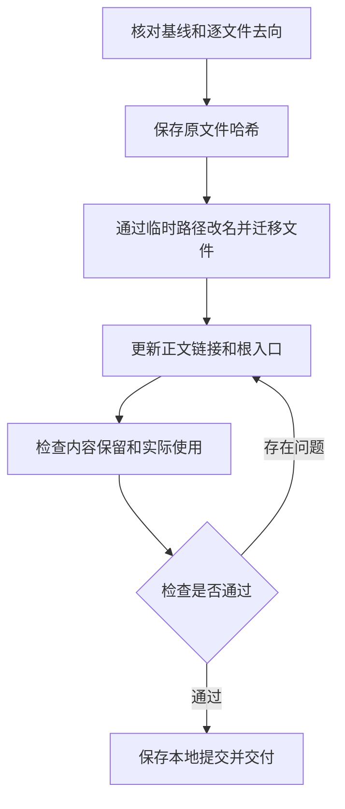

# 05 将项目工作区迁入新体系

本地迁移已完成，文件与实际材料检查通过，正文和证据同批保存到 main，迁移提交为 `5c87c91`（父提交 `c13ae5e`）。提交后工作区干净，收尾记录继续维护本文件。新产品实现与 TEAM 控制工作树同步仍属后续工作。

## 目标、授权与基线

Karl 要求使用 PROJECT01“做文件结构迁移到新体系”。本任务迁移当前 main 的文档、任务、演示与证据，更新根入口和本地引用，保留愿景、最终体验、历史原型条件及未验收事实。不修改产品行为、原型程序、插件加载目录、通用技能、其他会话或 TEAM 控制工作树，不创建远端对象。

开始时项目在 main，基线为 `c13ae5e`，工作区与暂存区干净，没有远端、嵌套仓库或非依赖符号链接。旧 `.project/` 内的文件均已跟踪；基线可恢复原内容。迁移前另在临时目录保存源文件哈希与逐文件对应关系，最终检查结果写回本任务。

## 文件去向与理由

| 旧位置 | 新位置与职责 | 检查办法 |
|---|---|---|
| `.project/00-index.md` | `.PROJECT/00-INDEX.md`，只导航长期正文及任务入口 | 回读实际链接，不复制任务状态 |
| `.project/01-product/PRODUCT.md` | `.PROJECT/01-PRODUCT.md`，保留完整愿景与最终体验 | 除路径更新外正文保留 |
| `.project/01-product/page-guide-agent.md` | `.PROJECT/modules/page-guide-agent.md`，保留 R1–R24、当前要求、历史证据与缺口 | 对照基线和新的 EVAL 入口 |
| `.project/02-tasks/` | `.TASK/`，任务编号及文件名稳定，索引改名为 `00-INDEX.md` | 目标、授权、版本、未完成项保留；不新建并行状态 |
| `.project/04-artifacts/conversation-driven-annotations/` | `.PROTOTYPE/validation/conversation-driven-annotations/`，保存已有兼容检查材料 | 每份文件逐字节哈希相同 |
| `.project/04-artifacts/surface-tutorials/` | `.PROTOTYPE/surface-tutorials/`，保存已有软件说明演示、观察记录与图片 | 哈希相同，HTML 与 Markdown 图片可加载 |
| `.project/README.md`、`03-docs/README.md`、`05-prototypes/README.md` | `.PROTOTYPE/legacy-workspace/`，冻结旧目录说明供追溯 | 原字节保留，不作为当前运行规则 |
| `.project/04-artifacts/.gitkeep` | `.PROTOTYPE/validation/.gitkeep` | 保留原字节，不清理历史材料 |
| 根目录没有的实际入口 | 新增 README、EVAL、架构与开发说明；依据现有规格和源码填写 | 不编造运行能力、命令或发布状态 |
| `prototype/`、`skill/`、package 与锁文件 | 留在原位；原型 README 更新正文入口 | 原型使用绝对任务路径，保持安装与运行兼容 |

`.project` 与 `.PROJECT` 在本机大小写不敏感文件系统上指向同一目录；通过未占用的临时中间目录改名，再拆分文件。旧空目录在全部文件迁出后移除，不丢弃文件，也不创建兼容副本。

## 工作过程

## 验证与当前结果

按对应关系完成 28 个文件的去向核对，其中 19 份纯移动文件的 SHA-256 与迁移前完全相同。产品、模块、四个原 Task 与任务索引共 7 份正文逐行对照基线，除列明的路径与 TEAM 布局说明调整外，原内容按原顺序保留；Task 02 的 T5/T6 未验收仍保留。41 份原型程序、任务包、样本、历史 Skill 与 package 文件的哈希未变。

27 份 Markdown 的 101 个本地链接、3 个章节引用、代码块闭合、旧路径分类及 Git diff 检查通过。旧目录说明冻结归档；Task 01/02 保留历史授权路径，Task 03 保留控制工作树的实际旧范围，不作全库历史替换。`.gitignore` 移除冗余的旧 `.project/build/` 条目，原有 `build/` 继续忽略工程缓存；没有缓存清理。

实际执行 README 的 Python 静态服务命令，在隔离 headless Chrome 打开迁移后的 HTML：返回 200，五份页面图片正常加载，15 个标记保留，点击代理页与标记后解释出现，页面脚本无错误。迁移工作图用本机现有 Mermaid 实际渲染，已读回截图确认中文与连线可读。六项浏览器检查全部通过，临时服务已停止。

检查证据：[结果与哈希](../.PROTOTYPE/validation/workspace-migration/validation.json)、[迁移工作图](../.PROTOTYPE/validation/workspace-migration/migration-workflow.svg)、[演示截图](../.PROTOTYPE/validation/workspace-migration/migrated-tutorial.png)。这次检查只证明文件迁移与旧材料可用，不证明新内置浏览器标注体验成立。

新入口恢复由本会话作者核对：AGENTS → PROJECT 索引 → PRODUCT 愿景与模块当前要求 → EVAL → 原 Task 的版本、结果与未完成项 → 开发检查方法，均可查找。没有启动独立审查 Agent 或新 Codex 会话，不称为独立接续验证。AGENTS 保持根目录发现位置，本机项目文件不到 10 KiB；全局文件单独计量为 19818 字节。配置未显式设置 project_doc 选项，本轮只确认文件与引用，未实测新会话加载。

未安装或替换插件，未运行会改写原型证据的 CDP 脚本，没有重新安装依赖；`npm test` 是原有失败占位，不作为验收。更新根 README、AGENTS 与 PROJECT 索引，补充架构及开发说明，EVAL 从现有 R17–R24 和产品边界整理八项核心判断，没有修改产品要求。

## 外部路径与接续

TEAM 控制工作树仍在 `/Users/zhouqi/.codex/worktrees/page-guide-team/51-page-guide-agent`，本次不修改其旧布局、运行记录、岗位产物或消息中的路径。main 的 Task 03 继续提供建设定义；实际运行进度仍去控制目录的旧 `.project/02-tasks/03-project-team.md` 查找，已核对文件存在并在根 AGENTS 链接准确位置。既有会话消息与打开的文件标签可能保留旧路径，后续从根 AGENTS 和新索引进入。本轮只能验证当前仓库引用，不能声称其他会话已同步。

上一轮的临时 `check_docs.py` 和 `validate.cjs`（位于 `/tmp/page-guide-docs-20261001/`）也已按新对应关系更新读取与输出路径，避免原样重跑时重建旧布局；本轮仅检查脚本语法，没有重跑会覆盖旧报告的兼容验证。

产品运行能力仍未迁移。文件结构更新不授权启动团队、安装插件或实现内置浏览器通信。
