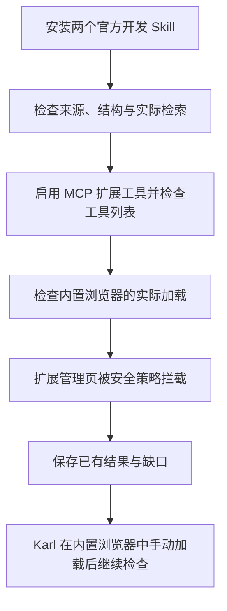

# 官方扩展开发工具与内置浏览器接入检查

## 本次要完成什么

Karl 在扩展管理页看到官方 Extensions 和 Web Store Skill，询问它能否自动编译和安装插件。说明 CLI、Skill 与 DevTools MCP 的职责后，Karl 回复“好，继续”，授权安装官方 Skill，并检查自动加载到 Codex 内置浏览器的条件。

本次增加开发工具，验证安装与工具发现；不修改产品插件，不替换旧原型，不启动 TEAM。产品要求仍以 [PRODUCT](../.PROJECT/01-PRODUCT.md)、[R18–R23](../.PROJECT/modules/page-guide-agent.md#当前需求)和 [EVAL](../EVAL.md) 为准，独立 Chrome 的开发能力不能替代内置浏览器验收。

## 当前做法与结果

1. 使用 skill-installer 的 GitHub 安装脚本，从 `GoogleChrome/modern-web-guidance` 的提交 `84ae7251ee919239d5ea85aef25897983f26601e` 安装 `skills/chrome-extensions` 与 `skills/modern-web-guidance`，保留官方原文。两个安装目录已创建，结构检查通过；分别 24 与 163 个文件，与官方提交的 Git blob 哈希逐一一致。CLI 实际检索并读取了 `position-aware-tooltips` 指南。
2. 现有 `/Users/zhouqi/.codex/config.toml` 已有 `chrome-devtools` MCP。仅在原启动参数中增加 `--categoryExtensions`，其余配置保持原样。使用该配置另启动 MCP，执行 `initialize` 与 `tools/list`，服务版本为 `1.10.1`，实际返回全部五个扩展管理工具；没有调用浏览器动作。当前会话原工具列表没有扩展管理工具，修改文件不代表运行中的服务已经重载。
3. 检查内置浏览器实际加载条件。Computer Use 能识别当前 Codex In-app Browser 及 Semrush 标签页，但打开 `chrome://extensions/` 被浏览器安全策略拒绝：自动化只允许 HTTP/HTTPS，且禁止通过其他入口、原始 CDP 或浏览器命令绕过。没有继续尝试绕过，没有安装或卸载浏览器扩展。

## 完成条件与当前缺口

完整 Skill 安装、CLI 检索与读取、MCP 启动与扩展工具发现已经通过。这些只证明开发工具配置成立，不证明浏览器扩展已安装。两个 Skill 会在后续轮次被发现；MCP 新工具需运行服务重新加载。

内置浏览器加载、内容脚本执行、对话调用标注、更新与清理目前未取得证据。受安全策略影响，本轮不能完成实际加载验证；下一步需要 Karl 手动在内置浏览器加载准确的扩展目录，之后在可访问的 HTTP/HTTPS 页面继续检查。旧 `prototype/extension/` 仍有 Side Panel，不应当记成新产品实现。

手动加载目录是 `/Users/zhouqi/Desktop/工作区/51-page-guide-agent/prototype/extension`。这份旧 manifest 会在全部网页匹配内容脚本，并声明 `activeTab`、`scripting`、`storage`、`sidePanel`、`tabs` 与 localhost / file 访问；它不是只作用于一张测试页的最小扩展。加载只用于确认旧原型的兼容性，不能悄悄把它作为新产品最终安装版。Karl 加载后，先确认扩展名称、版本、加载目录及目标网页，再验证内容脚本；不要以教程播放器能打开就判定对话标注成立。

## 检查与版本

- 本次开始时项目工作区干净，当前分支沿用 main；技能仓库存在其他工作的未提交修改，本次不暂存或覆盖。
- 安装脚本返回两个 `Installed ...` 成功结果。
- CLI 环境：Node `v24.14.0`、npm `11.9.0`、Python `3.14.4`。现有 MCP 配置中的 PATH 可解析 Node `v22.20.0` 与 pnpm。
- npm 当前发布版：`modern-web-guidance 0.0.191`、`chrome-devtools-mcp 1.10.1`；执行时取得，不作为长期最低版本要求。
- `quick_validate.py` 对两个 Skill 均返回 `Skill is valid!`；187 个文件的官方来源检查通过。
- CLI search 返回与提示定位相关的五个指南，retrieve 返回 `position-aware-tooltips` 的完整说明；检查的是实际 CLI，不把安装目录存在当成检索成功。
- MCP 协议检查返回五个扩展管理工具，缺失数为 0；工具实例在检查后关闭，没有启动或安装浏览器扩展。
- 工作图已在允许访问的本地 HTTP 页面使用现有 Mermaid 实际渲染，读回为七个节点、六条连线；已检查中文截图，检查页及临时服务随后关闭。
- 技能仓库本地提交：`bead17b7`。提交只包含两个新增 Skill 目录；保留其他工作原有修改。Git 空白检查报告了官方文件自带的行尾空格，因本次完整保留上游文件而未改写，不记作空白检查通过。
- 项目本地提交：`aceb7fe`，保存开发说明、架构与模块差距、Task 06、导航和检查 JSON；提交后项目工作区与暂存区干净。外部配置的实际变化是 `/Users/zhouqi/.codex/config.toml` 中新增一个启动参数，不在项目 Git 内。
- 项目静态检查通过：七份 Markdown 的围栏与 51 个本地链接、相应章节、检查 JSON 及 `git diff --check`；实际 diff 未包含原型代码、guide、package 或 TEAM 修改。结构与运行结果见 [检查记录](../.PROTOTYPE/validation/developer-tools/validation.json)。

## 当前状态与接续

开发工具准备已完成，内置浏览器实际加载等 Karl 手动操作后继续；任务保持待验状态。没有实现 R18–R23，没有启动、停止或修改 TEAM。手动加载完成后，不重复安装 Skill，按上面的准确目录与目标网页继续检查。

本次回看：实际 CLI 检索与 MCP 工具发现足以检查开发工具；浏览器策略阻碍属于当前执行环境，记录到原任务与开发说明，不扩展成通用 Skill 规则。没有另建经验文件或额外试用任务。

开发工具长期用法在 [开发说明](../.PROJECT/04-DEVELOPMENT.md) 维护，实际产品接入缺口在 [模块当前交付](../.PROJECT/modules/page-guide-agent.md#2-当前交付) 保留。
