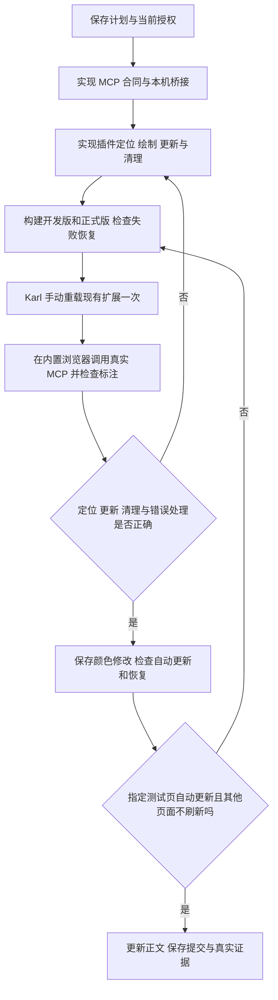

# MCP 页面标注与开发自动更新

## 目标与授权

Karl 希望直接在 Codex 对话中发送参数：定位真实 DOM，选择高亮、箭头或短提示，设置内容与偏移，也能一次传入多个标注。2026-10-02 明确要求“创建计划，然后实施”，授权本计划的代码、依赖、开发配置和验证。原有产品边界继续有效：没有独立插件前端；文字内容指标注文字，不代填业务表单、不自动点击或提交。

本次交付本机 MCP 工具到真实扩展的命令与反馈链，并接好此前已经接受的开发自动更新流程。先在专门测试页验证，再在无需业务写入的真实网页检查。连续步骤通过对话观察后再次调用，不增加固定教程播放器。当前要求依据 [EVAL](<../EVAL.md>) PGA-02～06、08 和 [模块规格](<../.PROJECT/modules/page-guide-agent.md>)。

## 调查基线与现有差距

源码基线为 main 的 `073ee57`，开始时工作区和暂存区干净。旧扩展位于 `prototype/extension/`，Karl 已手动加载 Page Guide Agent 0.1.0；[Task 06](<06-extension-development-tools.md>) 已证明内容脚本能在内置浏览器测试页绘制并清理。

现有 background.js 只有 Side Panel 设置；content.js 从 guide.json 播放步骤，选择器取第一个匹配，间距写死，没有对话请求和返回结果。根 package.json 是 CommonJS，仅有 playwright-core，没有实际构建或开发服务。现有 Codex chrome-devtools MCP 默认连接另一份 Chrome，不能作为本产品通信通道。

已核对官方 MCP stdio 与 Chrome WebSocket、消息、重载、storage.local 和 alarms 文档。MCP SDK 当前发布 1.31.0，ws 为 8.22.0，Node 为 v24.14.0。浏览器的 chrome:// 扩展管理页仍不允许自动化访问；源码准备完成后需要 Karl 手动重载一次。新 MCP 配置是否在当前会话自动发现也需实际核对，不把配置文件存在当成工具已加载。

## 推荐做法与理由

采用本机 stdio MCP 适配器、仅监听 127.0.0.1 的桥接服务、扩展后台 WebSocket、网页内容脚本。MCP 适配器与开发服务分开：多个 MCP 客户端可以共用桥接，开发监听不依赖某个对话是否正在调用工具。每次通信携带请求身份，插件返回实际结果。

相比直接连接 CDP，这个办法直接调用已安装扩展，并明确浏览器实例、标签页和文档归属；不用另启动 Chrome。相比把整个 MCP 服务塞进扩展，stdio 与文件监听交给本机 Node，扩展只处理页面与浏览器 API，职责更清楚。代价是需要本机服务持续运行，以及一次加载新后台的手动重载。

桥接使用本机密钥，保存在 Git 忽略的私有运行目录，生成的配置不提交密钥。拒绝未配对连接，MCP 不提供任意 JavaScript 执行或浏览器业务操作。页面句柄包含实例、tab、文档与 URL，过期页面拒绝执行；标注按调用方提供的会话 ID 分组，其他会话不会被默认清理。

## 工具与结果要求

| 编号 | 触发与结果 |
|---|---|
| MCP-01 | 调用页面列表时，返回真实已连接扩展与可用网页句柄；未连接时明确提示重载或启动服务。 |
| MCP-02 | 检查目标时，返回匹配数量、可见状态与边界；不存在、不唯一或旧文档都返回错误，不取第一个目标。 |
| MCP-03 | 创建标注时，接收数组，支持高亮、箭头、短提示或组合，以及相对目标的偏移；先验证全部目标，再执行本批修改。 |
| MCP-04 | 更新与清理只处理指定页面及会话；返回实际处理 ID 与结果。滚动、窗口和 DOM 变化后重新计算，失效标记撤下并报告。 |
| MCP-05 | 标注不拦截网页输入，不改业务 DOM 内容，不提供 Side Panel、任务卡或播放入口。 |
| DEV-01 | 成功生成全部文件后才发布版本；失败保留上一版。同版本不重复重载。 |
| DEV-02 | 重载前持久保存指定测试页，重载后核对 URL 和版本，只刷新仍属该测试的页面；开发服务停止、重启后能够恢复连接。 |
| DEV-03 | 开发重载器单独生成，正式产物没有重载入口或开发恢复记录；正式 MCP 桥接与恢复能力继续保留。 |

第一版定位覆盖 CSS、精确文字与标签，支持明确指定的同源 iframe 和开放 Shadow DOM 范围；跨源 frame、关闭 Shadow DOM、无法可靠换算的变换范围返回不支持。偏移控制提示或箭头位置，目标框仍贴合目标边界。布局会在视口边缘调整，并返回最终位置。

## 文件安排

```text
/Users/zhouqi/Desktop/工作区/51-page-guide-agent/
├── src/
│   ├── bridge.mjs                 [新增] 本机配对、请求转发、页面身份与超时
│   ├── mcp.mjs                    [新增] stdio MCP 工具与参数验证
│   ├── contract.mjs               [新增] 工具 schema 和命令合同
│   └── extension/
│       ├── background.js          [新增] WebSocket 与页面消息、实例身份和恢复
│       ├── content.js             [新增] DOM 核对、标注数组、更新与清理
│       └── dev-reload.js          [新增] 仅开发版的重载及测试页恢复
├── scripts/
│   ├── build.mjs                  [新增] 校验并生成开发、正式文件与版本
│   ├── dev.mjs                    [新增] 桥接服务、串行源码监听与版本发布
│   └── call.mjs                   [新增] 使用真实 MCP SDK 客户端检查工具调用
├── test/
│   ├── bridge.test.mjs            [新增] 配对、请求归属、超时和断开
│   ├── contract.test.mjs          [新增] 参数、数组、错误与会话约束
│   ├── renderer.test.mjs、reload.test.mjs [新增] DOM、会话、frame 限制与开发恢复
│   ├── build.test.mjs             [新增] 正式产物与构建失败保留
│   └── fixture.html               [新增] 专门测试 DOM、滚动、歧义和正常输入
├── prototype/extension/
│   ├── manifest.json              [修改] 移除侧栏声明，加载新的内容与后台
│   ├── background.js、content.js   [修改] 构建生成；保持已加载目录
│   └── 旧 sidepanel 文件           [保留] 未被 manifest 引用，仅历史材料
├── build/、.page-guide/             [忽略] 正式产物、运行密钥和开发状态
├── package.json、package-lock.json [修改] MCP、WebSocket、验证依赖与命令
├── .PROJECT/02-ARCHITECTURE.md      [修改] 实际合同与职责
├── .PROJECT/04-DEVELOPMENT.md       [修改] 启动、重载、目录与测试规则
├── .PROJECT/protocols/mcp-annotations.md [新增] 当前参数、返回和限制
├── .PROJECT/modules/page-guide-agent.md [修改] 实现与验收差距
├── README.md、.PROTOTYPE/README.md [修改] 当前启动与证据入口
├── .PROTOTYPE/validation/mcp/      [新增] 实际截图、工作图和版本记录
├── AGENTS.md、.TASK/00-INDEX.md     [修改] 当前任务和真实运行入口
└── .TASK/07-mcp-page-annotations.md [本文件] 计划、实施、授权与证据
```

Codex 外部配置只增加本项目 stdio MCP 条目，保留其他配置。源码与生成文件要有明确对应；每轮生成前完整校验，不直接修改输出目录作为正常开发办法。

沿用 Karl 此前“更新相关文档和技能”的授权，同批更新全局 LEARN03 主文及 `references/mcp-annotations.md`，说明先观察、取得页面句柄、检查目标、调用与验证实际结果。中文说明、机器 schema 保留原字段；旧 guide 合同只用于历史兼容。

## 实施顺序与恢复

先保存计划，再实现合同与本机服务，接着实现内容脚本和后台，最后接构建、开发监听、配置和真实验证。每组相互关联的文件验证后保存本地提交，沿用 main，不操作远端或 TEAM 工作树。



服务断开会取消在途请求并返回错误，不把排队旧请求在重连后自动重放。页面跳转会使旧句柄失效，需要重新取得页面身份。开发自动重载只针对显式选定的测试页；未选页面时可以更新扩展，但不刷新其他网页。

## Agent 分工与拓扑

主 Agent 保存计划、实现和真实页面验证。只读资料调查依 PLAN01 与 SUBAGENT02 委托，未委托业务实现；旧 review_definition_and_skills 不参与本次任务。

```text
主 Agent：/root（模型与推理设置未由工具返回）
负责计划、全部实现、浏览器验证、提交与记录
    |
    +-- /root/mcp_runtime_research：gpt-6-luna / high [已完成，只读]
    |   核对 SDK 参数验证与 MV3 重载/恢复条件
    |
    +-- /root/review_mcp_skill：gpt-6.1-sol / 推理设置未取得 [已完成，只读]
        独立检查 LEARN03 新旧内容、调用合同与中文表达
    |
    v
同一主 Agent：核对关键来源并更新本文件的结果
```

## 验证与完成条件

| 检查 | 操作与应有结果 | 当前状态 |
|---|---|---|
| MCP 协议 | 用 SDK 初始化、列工具、执行真实工具；参数错误与未连接返回可理解错误 | 通过：六项工具；服务停止时返回 BRIDGE_UNAVAILABLE |
| 批量与精确定位 | 两个实际目标同时标注；同名多个目标拒绝，合法旧标注保留 | 通过：关键词与比较按钮；重复目标匹配 2 个被拒绝；同源 frame 和开放 Shadow DOM 也通过 |
| 页面与会话归属 | 错页、旧文档、其他会话清理被拒绝或不影响现有标注 | 通过：旧文档 STALE_PAGE；清理第二会话不影响第一会话 |
| 偏移与动态布局 | 改偏移、滚动、改变尺寸、移除目标，观察真实标注跟随或撤下 | 通过：x 偏移增加 30，提示也移动 30；离开视口撤下、返回恢复；600×720 视口提示收回；移除按钮后报告失败 |
| 网页正常操作 | 输入、按钮和滚动仍由用户操作；无侧栏与播放器入口 | 通过：通过浏览器正常输入、比较与展开；manifest 无侧栏 |
| 开发自动更新 | 保存颜色变化后不手动刷新，真实扩展显示新色；恢复原色同样自动生效 | 通过：紫→红→紫自动生效、文档 UUID 改变、标注恢复；另一页输入保留 |
| 失败与重启 | 错误源码不发布；重复通知不循环；服务重启后自动恢复连接 | 通过：语法错误与恢复同版本均不重载；服务停止约 95 秒后重启自动连接，页面文档不变 |
| 正式产物 | 实际文件不含开发重载脚本和开发入口；产品 MCP 通信保留 | 通过：实际生成目录与自动文件检查；最终正式版本 33b7b17f391638ac |
| 真实网页 | 在一个可读取网页用 MCP 标出对象并清理，不执行业务写入 | 通过：Chrome 官方扩展 AI 文档 h1，高亮后清理，页面标注根节点消失 |

模拟传输只验证服务行为，不能替代真实插件。必要的首次手动重载不计入自动更新验收；本轮工具调用走真实 MCP 协议，若当前 Codex 原生工具列表未刷新，准确记录 SDK 客户端调用与会话工具发现的区别。

## 当前进展、版本与证据

本次 MCP 和开发更新的实现与上述九项检查已完成。计划提交为 `18ec6e0`，实现为 `4bc03a6`，离线错误提示为 `c5da4ac`，frame 限制补齐为 `6160913`；均在 main 本地保存。最终实际安装版本为 0.2.0，目录仍是 `prototype/extension/`，开发构建 `fce576ac325ef9d7`，正式构建 `33b7b17f391638ac`。`npm test` 最终 11 项全部通过；依赖安装 audit 为 0。

Karl 完成首次重载后，真实扩展实例 `043301e2-6e1f-43c5-8e77-ec45dd04944b` 已连接。SDK 通过 stdio MCP → 桥接 → 安装扩展调用六项工具，浏览器观察验证实际 DOM、截图与正常操作；没有直接注入扩展源码或用模拟 Chrome API 替代安装验收。测试页是 `http://127.0.0.1:8767/fixture`，最终文档为 `8d1a16fa-ee71-4f71-840a-49aa859eaeea`。

截图与版本说明在 [验收目录记录](<../.PROTOTYPE/validation/mcp/validation.json>)。[批量标注](<../.PROTOTYPE/validation/mcp/batch-rendered.jpg>)、[偏移与正常输入](<../.PROTOTYPE/validation/mcp/updated-and-input.jpg>)、[移除目标](<../.PROTOTYPE/validation/mcp/target-removed.jpg>)、[自动红色更新](<../.PROTOTYPE/validation/mcp/auto-reload-red.jpg>)、[恢复紫色](<../.PROTOTYPE/validation/mcp/auto-reload-restored.jpg>)、[缩小视口](<../.PROTOTYPE/validation/mcp/resized-viewport.jpg>)、[同源 frame](<../.PROTOTYPE/validation/mcp/frame-rendered.jpg>)、[真实网页高亮](<../.PROTOTYPE/validation/mcp/public-page-rendered.jpg>)与[清理](<../.PROTOTYPE/validation/mcp/public-page-cleared.jpg>)对应具体操作。工作图已实际渲染，见 [计划图](<../.PROTOTYPE/validation/mcp/plan-diagram.png>)。

颜色验收在开发版本 `ba5726e8fa720b99` → `aed39906ac027f97` → `ba5726e8fa720b99` 完成，输入因测试页刷新清空；另一个测试标签页的输入保留。制造一次源码语法错误后，构建拒绝、输出和文档不变；删除错误后因版本相同也没有重复重载。随后补齐 frame 的变换祖先与裁切检查，增加回归并在最终版本重新标出普通同源 frame，两个主标注也自动恢复。

开发服务停止约 95 秒后重启，SDK 从 BRIDGE_UNAVAILABLE 恢复到 connected: 1，文档 UUID 未变，未手动重载。此检查证明服务恢复后的自行重连，没有直接确认 worker 已进入休眠。正式产物剥离开发重载与快照，正式浏览器目录另行安装没有执行。

已在 `/Users/zhouqi/.codex/config.toml` 增加 `page-guide-agent`，保留其他服务；TOML 解析和 `codex mcp list` enabled 检查通过。当前对话的原生工具列表尚无这六项，实际证据来自真实 SDK 客户端。下一次自然开始的对话或 MCP 服务重新加载后，应先确认原生工具发现，再走一次所问网页的完整多轮帮助。复杂业务网页多轮体验、本地持久复用仍属于产品后续验收，不记成此次基础能力已经全部证明。

`npm run guide:dev` 保持在本机 8767 运行，最终测试页保留两个标注供 Karl 查看；临时真实网页与辅助标签页已清理，原有标签页未改动。

收尾检查：11 份入口与正文的 89 个本地链接均存在，验收 JSON 可解析且 11 个图像文件齐全；Git diff 无空白错误。辅助图形服务已停止，临时视口覆盖已恢复。正文和截图同批保存本地提交，不操作远端。

SDK 调查已收回。官方 1.31.0 的低层 Server 不替工具执行 inputSchema 校验，因此适配器和桥接都调用 Zod parse；storage.local 及 alarm 的恢复条件已进入实现。来源：[SDK Server](https://github.com/modelcontextprotocol/typescript-sdk/blob/1.31.0/src/server/index.ts)、[Chrome storage](https://developer.chrome.com/docs/extensions/reference/api/storage)、[生命周期](https://developer.chrome.com/docs/extensions/develop/concepts/service-workers/lifecycle)。子代理没有验证内置浏览器，主 Agent 的源码与自动检查也不替代安装验收。

实施检查中发现中文项目路径使 URL pathname 保持百分号编码，导致 build CLI 未进入；已改用 fileURLToPath，重新运行正式构建，确认实际输出目录和版本。自动测试覆盖模拟传输、DOM 算法与重载状态；安装验收另用实际 SDK 和内置浏览器完成。

LEARN03 与 MCP 方法资源已通过结构验证及独立审查，没有重要问题；技能仓库提交为 `6c72b69d`，原有其他未提交修改保留。主 Agent 已核对调查与审查结论，并完成上述真实标注验证。

## 重要变化

- 2026-10-01：接受对话驱动与无独立插件前端；旧扩展兼容检查通过。
- 2026-10-01：开发自动更新流程写入 AGENTS，尚未实现。
- 2026-10-02：Karl 接受 MCP 参数调用方向并授权创建计划后实施；本计划保存当前范围和待执行验收。
- 2026-10-02：MCP、自动更新和真实页面标注检查完成；补齐 frame 变换与裁切限制。当前原生会话工具发现仍未刷新，后续完整体验验收继续保留。
