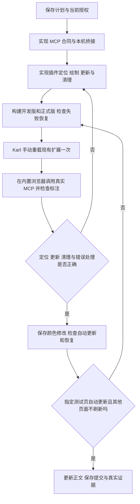

# MCP 页面标注与开发自动更新

## 目标与授权

Karl 希望直接在 Codex 对话中发送参数：定位真实 DOM，选择高亮、箭头或短提示，设置内容与偏移，也能一次传入多个标注。2026-10-02 明确要求“创建计划，然后实施”，授权本计划的代码、依赖、开发配置和验证。原有产品边界继续有效：没有独立插件前端；文字内容指标注文字，不代填业务表单、不自动点击或提交。

本次交付本机 MCP 工具到真实扩展的命令与反馈链，并接好此前已经接受的开发自动更新流程。先在专门测试页验证，再在无需业务写入的真实网页检查。连续步骤通过对话观察后再次调用，不增加固定教程播放器。当前要求依据 [EVAL](../EVAL.md) PGA-02～06、08 和 [模块规格](../.PROJECT/modules/page-guide-agent.md)。

## 调查基线与现有差距

源码基线为 main 的 `073ee57`，开始时工作区和暂存区干净。旧扩展位于 `prototype/extension/`，Karl 已手动加载 Page Guide Agent 0.1.0；[Task 06](06-extension-development-tools.md) 已证明内容脚本能在内置浏览器测试页绘制并清理。

现有 background.js 只有 Side Panel 设置；content.js 从 guide.json 播放步骤，选择器取第一个匹配，间距写死，没有对话请求和返回结果。根 package.json 是 CommonJS，仅有 playwright-core，没有实际构建或开发服务。现有 Codex chrome-devtools MCP 默认连接另一份 Chrome，不能作为本产品通信通道。

已核对官方 MCP stdio 与 Chrome WebSocket、消息、重载、storage.local 和 alarms 文档。MCP SDK 当前发布 1.31.0，ws 为 8.22.0，Node 为 v24.14.0。浏览器的 chrome:// 扩展管理页仍不允许自动化访问；源码准备完成后需要 Karl 手动重载一次。新 MCP 配置是否在当前会话自动发现也需实际核对，不把配置文件存在当成工具已加载。

## 推荐做法与理由

采用本机 stdio MCP 适配器、仅监听 127.0.0.1 的桥接服务、扩展后台 WebSocket、网页内容脚本。MCP 适配器与开发服务分开：多个 MCP 客户端可以共用桥接，开发监听不依赖某个对话是否正在调用工具。每次通信携带请求身份，插件返回实际结果。

相比直接连接 CDP，这个办法直接调用已安装扩展，并明确浏览器实例、标签页和文档归属；不用另启动 Chrome。相比把整个 MCP 服务塞进扩展，stdio 与文件监听交给本机 Node，扩展只处理页面与浏览器 API，职责更清楚。代价是需要本机服务持续运行，以及一次加载新后台的手动重载。

桥接使用本机密钥，保存在 Git 忽略的私有运行目录，生成的配置不提交密钥。拒绝未配对连接，MCP 不提供任意 JavaScript 执行或浏览器业务操作。页面句柄包含实例、tab、文档与 URL，过期页面拒绝执行；标注按调用方提供的会话 ID 分组，其他会话不会被默认清理。

## 工具与结果要求

| 编号 | 触发与结果 |
|---|---|
| MCP-01 | 调用页面列表时，返回真实已连接扩展与可用网页句柄；未连接时明确提示重载或启动服务。 |
| MCP-02 | 检查目标时，返回匹配数量、可见状态与边界；不存在、不唯一或旧文档都返回错误，不取第一个目标。 |
| MCP-03 | 创建标注时，接收数组，支持高亮、箭头、短提示或组合，以及相对目标的偏移；先验证全部目标，再执行本批修改。 |
| MCP-04 | 更新与清理只处理指定页面及会话；返回实际处理 ID 与结果。滚动、窗口和 DOM 变化后重新计算，失效标记撤下并报告。 |
| MCP-05 | 标注不拦截网页输入，不改业务 DOM 内容，不提供 Side Panel、任务卡或播放入口。 |
| DEV-01 | 成功生成全部文件后才发布版本；失败保留上一版。同版本不重复重载。 |
| DEV-02 | 重载前持久保存指定测试页，重载后核对 URL 和版本，只刷新仍属该测试的页面；开发服务停止、重启后能够恢复连接。 |
| DEV-03 | 开发重载器单独生成，正式产物没有重载入口或开发恢复记录；正式 MCP 桥接与恢复能力继续保留。 |

第一版定位覆盖 CSS、精确文字与标签，支持明确指定的同源 iframe 和开放 Shadow DOM 范围；跨源 frame、关闭 Shadow DOM、无法可靠换算的变换范围返回不支持。偏移控制提示或箭头位置，目标框仍贴合目标边界。布局会在视口边缘调整，并返回最终位置。

## 文件安排

```text
/Users/zhouqi/Desktop/工作区/51-page-guide-agent/
├── src/
│   ├── bridge.mjs                 [新增] 本机配对、请求转发、页面身份与超时
│   ├── mcp.mjs                    [新增] stdio MCP 工具与参数验证
│   ├── contract.mjs               [新增] 工具 schema 和命令合同
│   └── extension/
│       ├── background.js          [新增] WebSocket 与页面消息、实例身份和恢复
│       ├── content.js             [新增] DOM 核对、标注数组、更新与清理
│       └── dev-reload.js          [新增] 仅开发版的重载及测试页恢复
├── scripts/
│   ├── build.mjs                  [新增] 校验并生成开发、正式文件与版本
│   ├── dev.mjs                    [新增] 桥接服务、串行源码监听与版本发布
│   └── call.mjs                   [新增] 使用真实 MCP SDK 客户端检查工具调用
├── test/
│   ├── bridge.test.mjs            [新增] 配对、请求归属、超时和断开
│   ├── contract.test.mjs          [新增] 参数、数组、错误与会话约束
│   └── fixture.html               [新增] 专门测试 DOM、滚动、歧义和正常输入
├── prototype/extension/
│   ├── manifest.json              [修改] 移除侧栏声明，加载新的内容与后台
│   ├── background.js、content.js   [修改] 构建生成；保持已加载目录
│   └── 旧 sidepanel 文件           [保留] 未被 manifest 引用，仅历史材料
├── build/、.page-guide/             [忽略] 正式产物、运行密钥和开发状态
├── package.json、package-lock.json [修改] MCP、WebSocket、验证依赖与命令
├── .PROJECT/02-ARCHITECTURE.md      [修改] 实际合同与职责
├── .PROJECT/04-DEVELOPMENT.md       [修改] 启动、重载、目录与测试规则
├── .PROJECT/modules/page-guide-agent.md [修改] 实现与验收差距
├── AGENTS.md、.TASK/00-INDEX.md     [修改] 当前任务和真实运行入口
└── .TASK/07-mcp-page-annotations.md [本文件] 计划、实施、授权与证据
```

Codex 外部配置只增加本项目 stdio MCP 条目，保留其他配置。源码与生成文件要有明确对应；每轮生成前完整校验，不直接修改输出目录作为正常开发办法。

## 实施顺序与恢复

先保存计划，再实现合同与本机服务，接着实现内容脚本和后台，最后接构建、开发监听、配置和真实验证。每组相互关联的文件验证后保存本地提交，沿用 main，不操作远端或 TEAM 工作树。



服务断开会取消在途请求并返回错误，不把排队旧请求在重连后自动重放。页面跳转会使旧句柄失效，需要重新取得页面身份。开发自动重载只针对显式选定的测试页；未选页面时可以更新扩展，但不刷新其他网页。

## Agent 分工与拓扑

主 Agent 保存计划、实现和真实页面验证。只读资料调查依 PLAN01 与 SUBAGENT02 委托，未委托业务实现；旧 review_definition_and_skills 不参与本次任务。

```text
主 Agent：/root（模型与推理设置未由工具返回）
负责计划、全部实现、浏览器验证、提交与记录
    |
    +-- /root/mcp_runtime_research：gpt-6-luna / high [已启动，只读]
        核对 SDK 参数验证与 MV3 重载/恢复条件
    |
    v
同一主 Agent：核对关键来源并更新本文件的结果
```

## 验证与完成条件

| 检查 | 操作与应有结果 | 当前状态 |
|---|---|---|
| MCP 协议 | 用 SDK 初始化、列工具、执行真实工具；参数错误与未连接返回可理解错误 | 待执行 |
| 批量与精确定位 | 两个实际目标同时标注；同名多个目标拒绝，合法旧标注保留 | 待执行 |
| 页面与会话归属 | 错页、旧文档、其他会话清理被拒绝或不影响现有标注 | 待执行 |
| 偏移与动态布局 | 改偏移、滚动、改变尺寸、移除目标，观察真实标注跟随或撤下 | 待执行 |
| 网页正常操作 | 输入、按钮和滚动仍由用户操作；无侧栏与播放器入口 | 待执行 |
| 开发自动更新 | 保存颜色变化后不手动刷新，真实扩展显示新色；恢复原色同样自动生效 | 待执行 |
| 失败与重启 | 错误源码不发布；重复通知不循环；服务重启后自动恢复连接 | 待执行 |
| 正式产物 | 实际文件不含开发重载脚本和开发入口；产品 MCP 通信保留 | 待执行 |
| 真实网页 | 在一个可读取网页用 MCP 标出对象并清理，不执行业务写入 | 待执行 |

模拟传输只验证服务行为，不能替代真实插件。必要的首次手动重载不计入自动更新验收；本轮工具调用走真实 MCP 协议，若当前 Codex 原生工具列表未刷新，准确记录 SDK 客户端调用与会话工具发现的区别。

## 当前进展与下一步

计划已建立，调查基线已核对，代码实施待执行。SDK 与 MV3 调查子代理已启动，尚未返回。下一步安装锁定依赖并实现合同、桥接和 MCP 适配器。真实验收最后需要 Karl 手动重载一次，这是加载新增监听代码的前置条件；可独立完成的代码、检查与产物先全部准备好。

## 重要变化

- 2026-10-01：接受对话驱动与无独立插件前端；旧扩展兼容检查通过。
- 2026-10-01：开发自动更新流程写入 AGENTS，尚未实现。
- 2026-10-02：Karl 接受 MCP 参数调用方向并授权创建计划后实施；本计划保存当前范围和待执行验收。

