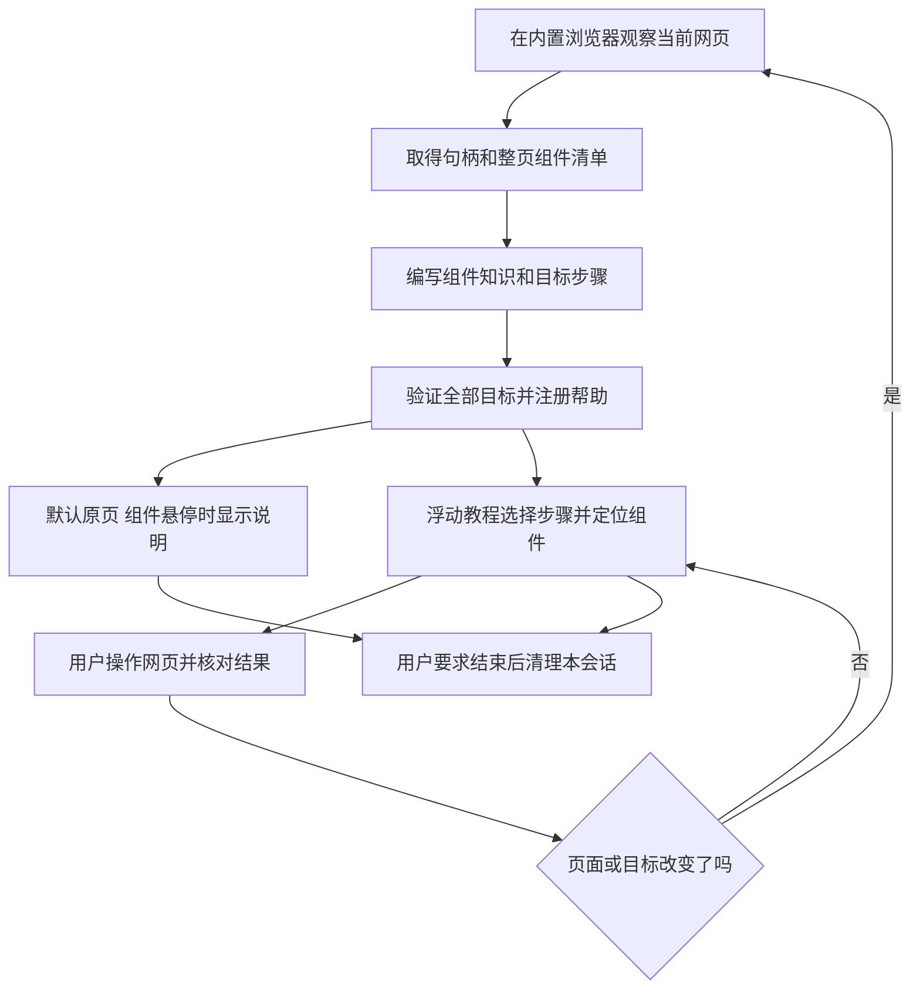

# 整页悬停知识说明与浮动教程

## 目标与授权

2026-10-12 Karl 要求工作方式转为：网页组件全量准备说明；内容有信息量和知识增量；文字遵循 Apple 技术支持风格；默认页面原样、仅悬停显示对应标注；用可访问的浮动教程将组件串联为达成特定目标的连续动作。例子使用指定 pump.fun ABU 页面，测试只用 Codex 内置浏览器，不访问 Chrome。

本次替代 Task 08 的常驻编号、线段、名称与知识只留在对话的限制。旧接口兼容，不恢复独立插件侧栏；对话继续负责需求理解、跨工具编排和深入追问。操作网页与确认业务结果仍由用户完成。

## Git 计划

| 字段 | 本次安排 |
|---|---|
| 起点版本 | main，`7bba76020c594724b72a5005ddfb9b3e27bfdc56`，开始时干净 |
| 分支与范围 | `codex/page-help-tutorial`，合同、渲染器、构建、检查、产品正文和本次样本 |
| 提交与验收 | 自动检查、独立只读审查、真实扩展 SDK 调用和内置浏览器鼠标及键盘检查后，本地提交 |
| 合并计划 | 向 Karl 提议合入 main；本轮没有另行合并授权 |
| 清理计划 | 不删除分支；合并后说明准确对象并等待 DELETE |
| 当前与下一步 | 实现与现场检查完成，随本任务保存本地提交；未合入 main，图表和隐藏状态的覆盖见缺口 |

## 实现与使用

`page_guide_inventory` 返回整页语义控件、指标文字、表格单元格、列名和定位。AI 结合现场编写 `page_guide_help` 的 `components` 和可选 `tutorial`；最多 1,000 个组件，单条说明 30–1,800 字符、整批正文最多 1.8 MB，最多 40 步。全部唯一目标验证后替换，视口外组件允许注册。

`src/extension/help.js` 显示悬停知识和浮动教程，默认无标注、框、线或底色。说明内容用纯文本。教程可前后查看、选步和收起，键盘可定位组件并在浮动窗阅读同一份知识；不自动点击原控件，不把切换步骤写成完成业务。同页仅一个帮助会话，另一会话不会遮盖它。原节点移除后不按同一 CSS 位置重绑。

本次说明样本和执行辅助在 `.PROTOTYPE/validation/task-09/`。`pump-help-content.mjs` 是这次实际页面的内容整理，不是预置网站库；`run-case.mjs` 重新扫描已打开的指定页面并通过真实 SDK 注册。进入其他状态后先重新核对，不直接重放旧句柄。

## 调查与文字依据

代码只读调查核对 `main / 7bba760`，当前旧六项工具、20 项批次、视口定位和常驻渲染已明确；新体验需要增加合同，而非只修改 CSS。

Apple 官方中文材料参考：[默认浏览器](https://support.apple.com/zh-cn/102362)、[录屏](https://support.apple.com/zh-cn/102653)、[轻点背面](https://support.apple.com/zh-cn/111772)。借鉴任务标题、必要条件、连续动作和检查结果的写法。说明采用“表示什么、怎样使用、怎样理解结果”的结构，具体含义优先于抽象名称。

Pump 机制参考：[联合曲线](https://pump.fun/docs/bonding-curve)、[当前费用说明](https://pump.fun/docs/fees)，后者正文日期 2026-10-08。没有把联合曲线费率写成所有阶段固定费用；钱包数不写成真实人数，市值不写成可卖出的现金。公开页面标题、真实中文控件和表格字段经内置浏览器观察；未核实的盈亏或平均成本计算不补造。

## 实际验证

- 指定页面：`https://pump.fun/coin/6hTLdzZaaCjmqtn7RtaEMQsCbXT5Pg8q76tRViEGpump`。内置浏览器标签页和 SDK 返回的 URL、标题一致；本轮没有访问 Chrome。
- 首次访问显示条款提示，要求 Karl 自行处理；页面随后可访问。服务启动后扩展未连接，Karl 明确回复“好 我已经重新载入了”。重载后后台连接成功，再刷新指定测试页面加载新内容脚本。
- 最终已加载开发目录 `prototype/extension/`，实际构建 revision `03aba01bf58eac76`。SDK 注册 750 个组件实例，初始 750 个可用、说明隐藏，教程为第 1 / 6 步。`registration.json` 保存页面句柄、版本和实际返回。
- 真实鼠标使用内置标签页的 `Input.dispatchMouseEvent` 移到“在价格与市值之间切换”，正确显示“比较价格与市值”及市值和流动性的区别，目标没有边框、底色或常驻编号。截图见 `hover.png`。
- 原生键盘在教程中选择步骤，并用 Return 激活“找到组件并阅读说明”，浮动窗读到流动性知识，页面滚动到真实组件；前后步、直接选步、收起和打开已检查。截图见 `tutorial.png`。
- 持有者搜索框输入 `itsbingo` 后仍显示对应值，再清空恢复。没有连接钱包、填写交易金额或提交交易。真实 SDK 清理后，内置浏览器 DOM 的帮助根节点数量为 0；随后重新注册供 Karl 查看。
- 最终留在页面的是收起后的“打开教程”入口，750 个组件仍可用，说明隐藏；`status.json` 和 `default.png` 保存这个状态。
- 自动检查 23 项通过，覆盖旧兼容、协议、桥接、构建、默认隐藏、原输入、教程导航、失效不重绑、会话冲突、不支持框架和整批字节限制。
- 独立只读审查发现框架内目标无法悬停、多会话重叠、合同和通信限额不一致，均修正并增加检查。

早期用同一份帮助代码作过页面注入测试；后续刷新已撤掉那次注入，最终截图来自真实扩展 SDK 注册，不把两类证据混用。

## 覆盖与缺口

750 是本次 DOM 中已注册实例数，含重复持有者行、表格数据、导航和指标，不能视为所有网站或所有隐藏状态全量验收。当前样本没有“组件名称加通用提醒”兜底，逐项采用对应类型的说明。

图表始终显示“正在加载图表”；当前只解释加载状态，内部图表控件尚无真实观察。未打开的喊单、交易、审核、配对代币等面板，其入口已有说明，内部新组件需要打开后重新观察和注册。帮助暂不支持 iframe。网站动态替换的新节点不会自动生成知识，需由 Codex 重新检查。

WEBTASK01/02 仍保存旧常驻名称与解释在对话的方法。本轮没有全局技能仓库修改授权，准确交接为：增加整页组件覆盖、知识说明及 Apple 文风，改为默认隐藏与悬停呈现，增加浮动连续教程的键盘路径，按新合同核对状态与清理；旧 connector 只用于兼容。本项目正文和接口已按新要求更新，不把未更新的通用技能当作新方法已同步。
