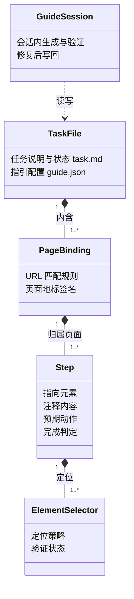
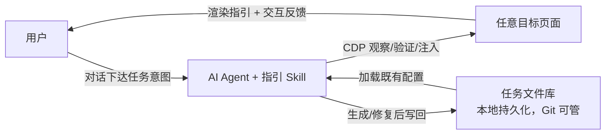
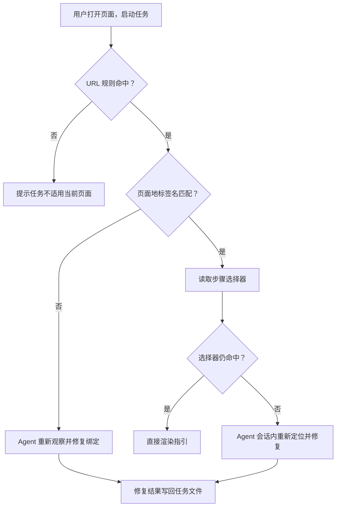

# 页面指引 Agent PRD

> 本 PRD 是「页面指引 Agent」核心能力模块的唯一文档权威和默认恢复入口。当前状态：需求定义已完成，尚未开始实现。

## 1. 稳定模块事实

### 1.1 用户现实与目标收益

用户（当前阶段为 Karl 本人）在使用复杂 Web 工具（典型如 Semrush 的设置与报表页面）时，经常无法理解页面上各功能的作用：不知道该填什么、先点哪里、各设置项之间是什么关系。现有解决方式是离开页面去问 AI、查官方文档或看教程；上下文断裂，且 AI 的回答无法与页面上的具体元素对应，用户仍需自己把文字答案映射回界面。

目标收益：用户不离开当前页面，通过对话让 AI 理解页面结构，并在页面上直接渲染出箭头、指针、注释和下一步指引；每次会话的学习成果沉淀为本地任务文件，同一任务重复使用时越用越准。

### 1.2 模块定义、边界与产品关系

本模块是产品 `51-page-guide-agent` 的核心能力模块，承载全部产品能力；`PRODUCT.md` 只保存跨模块摘要。

**能力边界**：

- 支持「任意网页」：只要有 CDP 协议可达的页面，AI Agent 就能观察页面并在会话内循环迭代。不做网页白名单、不做预置范围限制——这是产品级确认的设计决策，不是省略。
- 指引是「教学」不是「代做」：AI 生成并渲染指引，操作由用户自己完成。AI 可以读取页面、验证选择器、写回配置，但不替用户点击。

**不做事项**：

- 第一阶段不做 AI 自动替用户执行点击。
- 不做云端账号系统与多端同步。
- 不预置任何网站的静态指引配置库；指引配置一律由 AI 会话内生成，人工维护不是产品的长期形态。
- 不做与页面指引无关的通用爬虫或数据提取。

### 1.3 核心对象与语义



- **任务文件（Task File）**：持久化的独立文件对象，以「完成某件事」为用户心智单位。一个任务一个文件夹，内含人类可读的 `task.md` 与结构化的 `guide.json`；本地文件、可 diff、可进 Git、人和 AI 都能直接读写。
- **页面绑定（Page Binding）**：任务文件内的粗粒度匹配层——URL 匹配规则 + 页面地标签名（标题、关键标题文本、aria 结构锚点）。决定「这个页面是否属于本任务」。
- **步骤（Step）**：一步指引，含指向元素、注释、预期动作与完成判定。第一阶段只用单步注释，第二阶段引入步骤序列推进。
- **元素选择器（Element Selector）**：细粒度定位层，由 AI 在会话内生成并验证；修复后写回任务文件。
- **指引会话（Guide Session）**：AI Agent 的一次工作过程——观察、生成、验证、修复、写回。会话是生产者，不是持久对象。

**对象关系的核心规则**：任务文件是主对象，网页通过页面绑定关联到任务，而不是反过来以网页建文件。同一个页面可以承载多个任务文件。

### 1.4 需求目标与阶段边界

**第一阶段——页面结构识别与静态注释指引**。目标是验证整条流水线的生死假设：CDP 观察 → AI + 指引 Skill 生成 → 选择器验证 → 页面渲染。交付物是一个复杂页面上真实可用的注释指引（箭头 + 注释），以及沉淀该页面的任务文件。

**第二阶段——任务步骤指引**。在流水线已验证的基础上引入双向回路：步骤状态机、用户交互反馈、完成判定与失败提示。交付物是可完整走完一个任务的交互式向导。

两个阶段的分界线：第一阶段数据流单向（页面 → AI → 指引）；第二阶段开始引入用户交互反馈改变指引状态。

### 1.5 需求清单

| 编号 | 需求 | 阶段 |
|---|---|---|
| R1 | 用户通过自然语言对话下达任务意图（如「教我用这个功能」） | 一 |
| R2 | Agent 通过 CDP 观察任意页面结构（DOM / Accessibility / Runtime） | 一 |
| R3 | AI 依据指引 Skill 产出结构化指引配置（选择器 + 注释 + 可选步骤） | 一 |
| R4 | 在页面上渲染指引层：箭头、高亮、注释气泡 | 一 |
| R5 | Agent 用 CDP 验证每个选择器真实命中；未命中则重新观察修正 | 一 |
| R6 | 指引成果写入本地任务文件并持久化；同任务第二次打开可直接加载 | 一 |
| R7 | 三层绑定匹配：URL 规则 → 页面地标 → 元素选择器，逐层校验 | 一 |
| R8 | 会话内修复失效绑定与选择器后，把修复结果写回任务文件（自愈） | 一 |
| R9 | 指引失效时显性显示「指引过期」状态，不沉默失效 | 一 |
| R10 | 步骤推进状态机：等待用户完成 → 检测交互 → 推进下一步 | 二 |
| R11 | 用户交互反馈回传 Agent，指引状态随真实操作变化 | 二 |

### 1.6 约束条件

- **不限制支持的网页范围**（产品级确认）。任意 CDP 可达页面都在能力域内；网页改版由会话内迭代消化，不转为长期人工维护。
- **本地优先**：AI Agent 与任务文件都在本地；第一阶段不依赖云端服务。
- **任务文件是人类可读的本地文件对象**：格式简单、可 diff、可进 Git，人和 AI 都能直接读写。
- **Chrome 端保持薄**：渲染层与 CDP 桥只做渲染和反馈采集，不理解页面语义、不做 AI、不维护配置内容。
- **Skill 是独立资产**：指引方法论（如何观察页面、选择定位策略、验证命中、组织注释与步骤）沉淀在 Skill 中，与模型选择解耦；模型可换，Skill 累积。
- **指引配置不预置**：第一阶段验证的重点恰恰是「AI 能否对陌生页面凭空产出正确指引」，任何人工预置都会掩盖这个假设的验证。

### 1.7 方案

**组件与数据流**：



- **CDP 通道**：页面观察与验证的统一入口，是「任意网页」承诺的技术前提。
- **AI Agent + 指引 Skill**：产品决策核心。Skill 定义会话内工作法：先扫页面骨架再下钻、定位策略优先 role/aria/文本锚点、验证选择器命中、注释粒度、多步任务组织、失败表述。
- **渲染层（Chrome 扩展/注入脚本）**：把指引配置变成页面上的视觉层，并采集用户交互反馈。
- **任务文件库**：本地持久层。任务为主对象，内含三层绑定。

**任务文件结构**：

```text
tasks/
  semrush-keyword-research/
    task.md            ← 人类可读的任务说明 + 状态
    guide.json         ← 结构化指引配置（AI Skill 的产出物）
```

**三层绑定与匹配流程**：

| 层级 | 内容 | 变化频率 |
|---|---|---|
| 页面绑定（粗） | URL 匹配规则 + 页面地标签名 | 目标网站改版才变 |
| 步骤绑定（中） | 步骤归属页面 + 推进条件 | 任务定义变化时 |
| 元素选择器（细） | 具体元素定位 | 每次会话都可能刷新 |



**分层失败语义**：URL 不命中是「任务不适用」，正常提示；地标不命中是「页面可能改版」，进入重新观察；选择器不命中是「常规迭代」，会话内修复。三层失败都不沉默——用户总能看到指引层处于什么状态。

### 1.8 主流程与中断恢复

主流程（第一阶段）：用户在目标页面唤起 Agent → 对话说明意图 → Agent 读取任务文件（有则加载，无则新建）→ CDP 观察页面 → 按规则生成指引 → 逐条验证选择器 → 注入渲染 → 用户查看注释 → 会话成果写回任务文件。

中断恢复：任务文件即恢复面。会话中断、浏览器重启或换设备（同机）后，用户重新打开同一页面并选择任务，从任务文件加载已验证配置直接渲染；文件中没有或失效的部分由 Agent 会话内重建。

### 1.9 技术架构与平台边界

- 平台：Chrome（CDP 协议）+ 本机 Agent 运行环境。第一阶段不涉及服务端。
- 依赖方向：渲染层不依赖 AI；Agent 通过 CDP 单向控制页面；任务文件是 Agent 与渲染层之间唯一的持久交换物。
- Skill 与实现解耦：Skill 文档独立于插件代码演进；更换底层模型不改变 Skill 内容，只改变 Skill 的执行者。
- 持久化格式：任务文件用 Markdown + JSON，不用私有数据库；Git 是免费的版本与审计层。

### 1.10 可观察验收标准

**第一阶段（全部执行前属于稳定事实）**：

1. 给定一个此前未配置过的复杂页面（如 Semrush 某设置页），当用户对话发起指引，Agent 无需人工写任何配置，会话内产出指引并在页面渲染出不少于 5 条正确命中的箭头注释；每条选择器经 CDP 验证真实命中。
2. 注释内容经人工确认准确且有用（对元素作用、该填什么、与相邻项的关系），不是泛泛的控件名复述。
3. 当同一任务第二次打开，指引从任务文件直接加载渲染，无需重新生成（持久化生效）。
4. 当目标页面发生小改版，Agent 会话内重新定位失效元素，修复后写回任务文件，页面指引恢复。
5. 当 Agent 无法修复某条指引，页面显性显示「指引过期」，不显示错误指向或沉默消失。

**第二阶段**：

6. 给定一个多步任务（如「完成一次关键词调研」），用户按指引在页面上逐步完成操作，每步完成后自动推进到下一步，全程不离开页面、不求助外部文档。
7. 当用户跳过或做错某一步，指引状态如实反映（重试提示或失败说明），不虚假推进。

## 2. 当前交付

需求定义刚完成，实现尚未开始。产品边界、组件方案、任务文件结构、三层绑定与两阶段目标已经在对话中确认并写入本 PRD。

当前最大的交付差距：**第一阶段最小原型尚未存在**——还没有 CDP 连接、指引 Skill 文档、渲染脚本和示例任务文件。下一步由实现 owner 搭建最小原型验证验收标准第 1 条（生死假设：AI 能否对陌生页面凭空产出正确指引）。

## 3. 已验收目标证据

尚无已验收证据。实现尚未开始，验收标准 1–7 均未执行。

## 4. 长期踩坑点

尚无。原型阶段如果发现稳定的失败模式（例如某类页面 CDP 观察受限、某类选择器策略系统性失效），按触发条件、错误结果、避免方式记录到本节。
