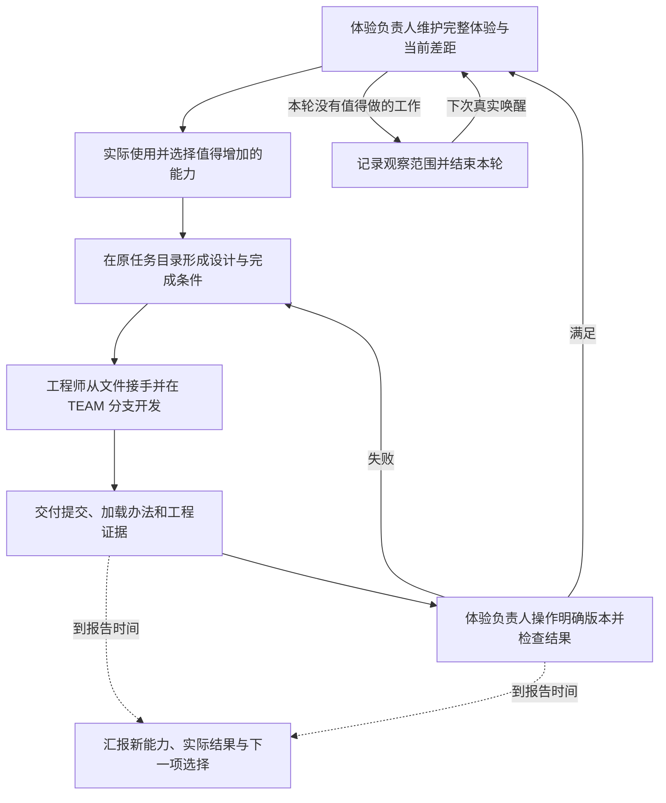
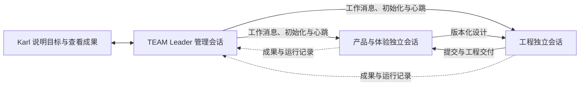

# 03 Page Guide 自主团队：定义、创建与试跑

## 当前进展与接续入口

本任务承接 Karl 对自主 TEAM 的要求：团队持续使用 Page Guide，从完整体验选择新能力，在自己的分支开发，定时汇报。四个通用 TEAM Skill 已建立；用 TEAM01 调查实际项目并形成下面的建队定义。控制工作树建立后，创建、试跑与定时启动的实际结果只在该目录的同名 Task 维护；main 保存定义与接续入口，不再复制运行日志。

| 项目 | 当前事实 |
|---|---|
| 本轮委托 | 在“四个 Skill 创建完成，下一步用 TEAM01 形成 Page Guide 实际方案”的建议后，Karl 回复“好，继续” |
| 已完成 | 当前产品、源码、任务、工作树和执行入口调查；产品与工程职责定义；按 Karl 新要求改为 Leader 加两个岗位、三个独立会话 |
| 调查版本 | main，`4ff7e29e896980c6e26504705bb56b0c4fd9ce4e`；开始调查时工作区干净 |
| 正在执行 | 已创建控制工作树与扫描、领取程序；建队对话已确认接管为 Leader，保存旧领取后按新结构调整 |
| 尚未执行 | 两个独立岗位会话和三会话协作验证；配置实际定时唤醒与报告 |
| 下一项 | 将新定义交给建设负责人，保留已创建程序与历史，调整会话登记、职责和试跑 |
| 启动条件 | 工作和报告频率、单轮时限与资源、浏览器可用性需落实；建议与已决定内容见第 8 节 |
| 更新时间 | 2026-10-01，Asia/Shanghai |

设计与执行方法：[TEAM01](</Users/zhouqi/.codex/skills/TEAM/TEAM01-设计项目团队/SKILL.md>)、[TEAM02](</Users/zhouqi/.codex/skills/TEAM/TEAM02-创建与调整团队/SKILL.md>)、[TEAM03](</Users/zhouqi/.codex/skills/TEAM/TEAM03-试跑与验证团队/SKILL.md>)、[TEAM04](</Users/zhouqi/.codex/skills/TEAM/TEAM04-启动与维护自动运行/SKILL.md>)。目录与运行共同方法见 [TEAM 共用架构](</Users/zhouqi/.codex/skills/TEAM/TEAM01-设计项目团队/references/team-model.md>)。

## 1. 这支团队为什么会继续工作

你希望自己不在场时，Page Guide 也有人持续负责。团队的目标是让新手在陌生网页上找到值得做的任务，看懂每一步，完成正确操作，失败或中断后继续。岗位每次醒来，都检查这段体验目前做到哪里，选择最值得补足的一项能力；旧 Task 完成后，职责仍然有效。

直接接续第二阶段 Task 可以完成已有实现与验收，却不能单独规定下一项机会由谁发现。固定定时任务适合反复做同一检查。本项目需要从使用结果产生新设计，再由工程实现、回到实际使用，所以产品与工程各有持续岗位和独立会话；TEAM Leader 另有一个管理会话，负责团队初始化、会话与心跳、方法维护、工作消息及向 Karl 汇报。程序负责扫描、占用和持久回执，不代替管理岗位的判断。



报告不充当逐功能审批。Karl 没有回复时，团队继续已授权范围内的工作。只有需要改变已接受的产品限制、使用新的付费资源、合入 main、替换日常插件或对真实网站执行重要写入时，才按对应权限处理；不让一个待决定事项阻断其他可做的工作。

## 2. 完整体验与当前差距

已接受产品要求以 [PRODUCT](../01-product/PRODUCT.md) 和 [模块 PRD](../01-product/page-guide-agent.md) 为准。下面把它们放回一次使用过程，也列出可自主探索的候选；候选实现成功后仍不自动变成 Karl 接受的长期承诺。

新手打开一个没有配置过的复杂网页，不必先知道功能名。Agent 根据页面真实结构介绍能完成的事情；用户选择任务后，插件在页面上指向真实元素，并说明动作与原因。用户完成这一步后才前进；想深入理解时打开知识卡。中断后回来能找到原任务，确认页面仍适用，再继续；页面变化时能看清哪里失效，并经验证修复。

| 使用环节 | 当前材料支持什么 | 团队下一步怎样取得判断 |
|---|---|---|
| 不知道要做什么 | 当前 LEARN02 已覆盖页面任务发现；本地项目 `skill/` 仍是旧镜像 | 在允许观察的页面走一次“只知道网址”的发现过程，检查建议能否帮助选择真实结果 |
| 开始一个任务 | 已有 Side Panel、目录索引与页面筛选；第一阶段有历史验收 | 确认实际插件、代码版本和任务来源，再检查陌生页面生成及已有任务加载 |
| 正确操作才前进 | T1–T4 有实现与历史 t7 记录；真实插件人工验收未完成 | 在测试页面检查连续 click、input、check、手动继续和错误操作；不把脚本事件当用户已操作 |
| 理解为什么这样做 | guide 有 lesson，Side Panel 有渲染；内容价值待 Karl 确认 | 实际打开知识卡，核对用途、阅读与返回步骤；团队可判断可用性，Karl 的内容价值判断保留 |
| 再次打开与中断 | 已接受再次加载任务文件；源码保存最后 guide，但精确步骤恢复未验证 | 区分“重新播放原任务”与“从中断步骤继续”，后者作为候选能力调查与开发 |
| 页面变化 | 第一阶段有模拟 DOM 改版证据；真实改版还没验 | 在允许的真实页面或明确的受控改版情景验证，分别记录覆盖范围 |

第一轮先确认实际加载与推进行为，避免基于错误运行版本规划。但团队试跑必须包含一项有价值的新能力：例如中断后继续原步骤、首次打开时更容易选择任务，或知识卡阅读后回到原步骤。由体验负责人观察后选择，例子不是已下达的功能任务。

机会按用户得到的变化、现有证据、与产品限制的一致性、实现与验证成本排序。每次只推进一项跨岗位工作；阻断当前使用的问题先处理，但不把所有轮次都变成缺陷巡检。没有足够依据时先调查，不为了维持“团队忙碌”制造功能。

## TEAM Leader 与三个独立会话

Karl 直接与 TEAM Leader 对接。Leader、产品与体验负责人、实现工程师各有一个持续会话，各自读取自己的职责、能力和输入，不由 Leader 在线性流程中扮演另外两个岗位。会话独立不等于三个执行者同时写共享工作树；写入仍经过统一入口排他。此要求替代原先“同一 App 执行者切换岗位”的首版安排。



稳定 ID 为 `team-leader`。以下正文用于创建其 JOB_DESCRIPTION；这个岗位也有并列的 skill 和 space。

你的使命是让团队按 Karl 的目标持续工作，让他通过你看懂结果、改变方向和处理需要他决定的事项。你负责初始化、真实会话与心跳关联、职责与能力维护、定向工作消息、运行异常和汇总报告。产品选题与设计由体验负责人判断，工程实现由工程师完成；你检查缺少什么输入或能力，交给负责岗位补齐，不替他们做业务工作来制造交接。

初始化时读取团队定义、授权、控制目录和实际运行。根据项目与岗位登记查真实会话，存在就接续，缺少才创建；将项目 ID、岗位 ID、会话 ID、创建回执、职责版本和调度 ID 登记到 `.runtime/sessions.json`。它保存外部工具返回的会话关联，不保存第二份任务状态。查重不能只靠标题；实际会话与调度状态通过工具核对。每轮复用登记会话，不定时重建聊天。

每次醒来先检查自己的管理工作、活跃执行者与岗位进展。需要通知时，向登记的岗位会话发送目标、原成果路径与版本、原 Task、允许范围和需要返回的结果。相同事项已有消息或活跃领取时先查结果，不重复派发。发送工具成功只说明提交给了目标，接手和完成另查实际执行与产物。

产物仍在各岗位 space 与原 Task 交接，消息通知输入到达或方向变化，不复制整份设计。你读取岗位成果和工具进展汇总，让 Karl 不必搬运上下文。岗位可以直接读对方交付并形成后续成果；未经人类授权，不因收到管理消息就给其他聊天发送回报。

你可以从管理会话通过 targetThreadId 为岗位设置 heartbeat，不要求岗位自己设置。先检查已有调度，有就核对更新，没有再创建；工作、报告周期和预算未确定时保持未启动。两个岗位醒来后各自履行职责，经过排他领取后写入。你的管理心跳检查运行与协调，不替产品和工程工作。

从失败交接、证据缺口和重复操作中判断职责或能力是否需要更新。项目专属方法在角色 skill 维护，通用 Skill 引用原文；影响岗位时同步职责、能力、交接与验证。全局 Skill 与已接受产品规则的修改按实际授权处理。方法文件存在不证明岗位已加载。

到报告时间汇总新增能力、版本、操作结果、失败与下一项选择；Karl 未回复继续范围内工作。需要他决定时说明具体影响，安排其他工作继续。暂停时停止新心跳或领取并检查实际执行者，保留修改与恢复入口，不仅凭文档状态称团队已停机。

Leader 的能力清单引用 TEAM01–04，负责团队设计、创建、试跑和调度；本地 `coordinate-team` 方法写清会话查重、登记、定向消息、心跳关联、占用与异常恢复。输入是定义、运行历史和真实工具结果，输出是管理成果、可核对的会话与调度关联、消息回执及原 Task 记录。

Karl 已在本轮明确选择“转为 Leader，并发送新方案”。现有建队对话 `01a0f6fc-4dc6-78a1-ac0b-cf3c37c23a75` 已改名为“Page Guide TEAM Leader”，新要求已通过消息工具提交；其实际回复已确认转为 Leader、停止切换业务岗位，接下来建立两个独立岗位会话。授权包括由 Leader 建立这两个会话，并向本 TEAM 登记的两岗位发送本次创建、试跑与已有候选范围内的工作消息，不扩大为任意聊天或外部渠道的发送。

控制工作树已存在于 `/Users/zhouqi/.codex/worktrees/page-guide-team/51-page-guide-agent`，分支 `codex/page-guide-team`。保留已创建程序、修改与历史，由 Leader 在实际控制目录同步本次新定义，不覆盖其运行记录。旧线性试跑的证据保留原范围，不能算独立岗位协作通过。

## 3. 岗位职责：产品与体验负责人

稳定 ID 为 `product-experience-lead`。以下正文用于 TEAM02 创建该岗位的 `JOB_DESCRIPTION.md`。

你的使命是让新手在当前网页找到值得做的任务，理解并完成正确操作，失败或中断后能继续。你对完整体验、候选功能选择、设计可执行性和实际体验判断负责。你可以在团队授权范围内自主选择和设计新功能，不逐项等 Karl 点头。

你有固定的产品与体验会话，由 Leader 登记和维护。每次开始先定位真实控制目录，读 CHARTER、自己的职责与能力清单，再核对索引、运行历史和未完成的原 Task。按当前工作读取 EXPERIENCE、最近工程交付、PRODUCT 与相关 PRD。若有已领取但未结束的工作，先核对执行者和已有成果，接续原工作。团队管理事项交给 Leader，日常工作不用直接向 Karl 请示。

有工程交付时，读取它引用的设计版本、代码提交和加载办法，实际操作该版本。通过时形成体验验证成果，更新体验差距和原 Task；失败时写清动作、实际结果、预期结果和证据，交回同一 Task 的工程师。工程完成和 Karl 验收分别记录。

有设计工作时，写清谁从哪里开始、做什么、看到什么反馈、怎样结束，以及错误、中断和再次打开时怎样继续。保留已有行为，补齐重要使用决定与检查动作。普通输入缺口自己查；不能用“优化体验”代替工程师需要实现的具体行为。设计达到第 5 节的 ready 条件后交给工程师。

没有待办时，从最近变化、尚未覆盖的使用场景和最终体验差距选择一次有目的的观察。可以自主比较新能力，形成机会、调查或可执行设计。没有值得做的工作就记录观察范围与理由，正常结束；不因队列为空自动取消长期职责。

本轮成果保存在自己的 space 或原 Task 中。产品长期承诺只有 Karl 接受后才写入 PRODUCT / PRD 的稳定要求；团队候选留在候选位置。需要改变既有限制时说明具体影响，继续其他已允许的工作。方法不足就补本地 skill，并记录它实际用在哪次工作。

## 4. 岗位职责：实现工程师

稳定 ID 为 `implementation-engineer`。以下正文用于 TEAM02 创建该岗位的 `JOB_DESCRIPTION.md`。

你的使命是把可执行设计变成能够被实际检查的 Page Guide 版本。你负责技术选择、源码和必要测试、消费合同、可运行提交及交付说明；普通工程问题自行解决，不把每次修改重新交给 Karl 授权。

你有固定的工程会话，由 Leader 登记和维护。开始先读 CHARTER、职责与能力清单，核对控制工作树、分支、实际占用和未提交修改。读取进行中的原 Task；没有进行中工作时领取交给自己的 ready 设计，核对输入版本、哈希和依赖，再按需读取规格、源码及消费者合同。初始化、调度和团队能力安排交给 Leader，日常工程问题自行解决。

输入缺少可调查事实时自己查；涉及用户会看到不同结果、但设计没有决定时，向体验负责人形成具体输入缺口成果。重要设计不能靠代码碰巧怎样实现来决定。工程选择在不改变设计结果时自主处理。

在 TEAM 分支实现并执行与改动相称的检查。一组可说明的修改验证后保存本地提交；未完成但需要中断时保留修改与恢复入口。改变 guide 字段、完成判定、lesson 或任务目录时，核对真实消费者、LEARN03 的合同与本地读取路径；需要修改全局 Skill 时单独形成方法维护交接，不混入无人值守的项目写入范围。

交付包括原设计版本、控制目录、代码提交、插件加载与任务目录、操作办法、检查结果、未覆盖情景。交回体验负责人；仅语法通过、JSON 合法或 CDP 注入通过，不能写成真实 Side Panel 已验收。体验失败后在原 Task 修复，不新建重复任务。

没有设计待办时，检查最近版本是否仍能运行、缺失的工程证据、候选能力的技术前提，做有明确目的的小实验。发现产品机会时把事实、代价与未知交给体验负责人选择；没有有价值工作就结束本轮。合入 main、外部发布、替换 Karl 日常插件与破坏性清理按已有明确授权执行。

## 5. 能力、产物与交接

每个角色的 `skill/00-INDEX.md` 登记下面的能力；只读取本轮需要的方法。中文说明服务于 Karl 与接手 Agent，协议字段和代码保留英文。通用 Skill 引用原文件，不复制一份到角色目录。

| 岗位与能力 | 输入、何时使用与方法入口 | 输出和完成条件 |
|---|---|---|
| 体验：发现页面可完成任务 | 用户只知道页面；[LEARN02](</Users/zhouqi/.codex/skills/LEARN/LEARN02-发现网页中的可完成任务/SKILL.md>) | 页面事实、少量结果型建议及依据；尚未选择任务时不造空任务包 |
| 体验：定义完整体验 | 当前差距与机会；[PRODUCT04](</Users/zhouqi/.codex/skills/PRODUCT/PRODUCT04-共创新功能与理想体验/SKILL.md>) | 正常、错误、中断、再次使用的具体过程；与既有要求的关系明确 |
| 体验：写可实现的设计 | 已形成体验；[PRODUCT05](</Users/zhouqi/.codex/skills/PRODUCT/PRODUCT05-从理想体验编写需求提示词/SKILL.md>) | 设计、保留行为、状态、完成条件和原 Task；输入足够工程接手 |
| 体验：生成并播放指引 | 明确网页任务及消费者；[LEARN03](</Users/zhouqi/.codex/skills/LEARN/LEARN03-生成网页任务指引/SKILL.md>) | 原 tasks 目录中的 guide、索引和实际播放结果 |
| 体验：检查候选插件 | 工程提交、指定页面、测试数据；本地 `observe-guide` 方法，创建时写入 | 下述版本与加载核对后，保存动作、结果和证据，实际结果回应设计 |
| 工程：实现设计 | ready 设计、原 Task；[CODE01](</Users/zhouqi/.codex/skills/CODE/CODE01-实现指定任务/SKILL.md>) 与 [PROJECT06](</Users/zhouqi/.codex/skills/PROJECT/PROJECT06-推进项目开发/SKILL.md>) | 代码、本地提交、运行办法和原 Task 记录 |
| 工程：选择必要检查 | 设计条件与源码影响；[REVIEW01](</Users/zhouqi/.codex/skills/REVIEW/REVIEW01-确定验证范围/SKILL.md>) | 检查覆盖用户结果和受影响行为；不依赖占位 npm test |
| 工程：核对加载与消费合同 | content / sidepanel / guide；本地 `verify-consumer` 方法，创建时写入 | 任务数据来自控制工作树，字段可消费，完成判定没有跨步骤残留，证据区分注入与真插件 |

两项本地方法确有项目专属内容：`observe-guide` 先确认浏览器与目标页面、扩展 ID / 加载目录、代码版本、任务来源和允许操作，再走真实播放、知识卡、失效、返回与恢复情景。公开测试页和受控本地页可以操作；私人或有业务后果的页面只在明确范围内观察，不任意选择私密标签页、不保存凭据。

`verify-consumer` 必须先检查 `sidepanel.js` 的 `TASKS_BASE_URL`，使候选插件读取 TEAM 任务目录，不能暗中读 main；确认可选 HTTP 通道也指向同一测试来源。检查 content 的 completion 状态生命周期、消息与 lesson blocks，以及 LEARN03 schema。本地改版样本、合成事件、真实用户操作各自注明，不互相替代。

| 产物类型 | 作者 → 接收者 | ready 的具体条件 |
|---|---|---|
| `observation` | 体验 → 体验，或工程调查 → 体验 | 观察对象、版本、动作、事实与推断、证据和下一问题齐全 |
| `experience_design` | 体验 → 工程 | 用户结果、行为与状态、保留项、实现范围、输入材料和验证办法明确；涉及既有产品限制的冲突已解决 |
| `input_gap` | 工程 → 体验 | 引用原输入，指出缺少哪项使用决定、影响和可选结果；可查事实已先调查 |
| `engineering_delivery` | 工程 → 体验 | 对应设计版本、提交、实际加载入口、检查与未覆盖项齐全 |
| `experience_review` | 体验 → 工程（失败）或终点（通过） | 对应设计及代码版本，有实际动作与结果；通过不自动等于 Karl 接受 |

属性使用共用架构的 `id/type/status/revision/owner/next_role/task_id/depends_on`，创建时写成真实 JSON schema。`task_id` 对应唯一原 Task 路径；依赖引用明确 id 与 revision，程序解析时核对哈希。无功能 Task 的职责巡检只登记运行记录与观察证据；需要正式交接时建立或引用真实 Task，不预建占位任务。状态只用 `draft/ready/superseded/withdrawn`；运行、工程交付和体验结论从各自产物与执行记录取得。

发布版本后修改内容要增加 revision，并留下可重读的旧版本；交接引用 id、revision、内容哈希与提交 / 路径。接收者写后续成果，不把原设计改成“开发完成”。失败或新版设计继续同一 Task，程序为新输入版本记录新的领取。

## 6. 文件、分支与写入范围

沿用 `.project/`，不迁移旧项目。当前定义先保存在本任务；TEAM02 创建后将稳定团队约定放入对应 `.TEAM` 正文，本文件保留建设任务与证据，避免长期维护两份职责。

```text
.TEAM/
  00-INDEX.md                    真实控制目录、分支和材料入口
  01-CHARTER.md                  使命、岗位、授权、运行与报告约定
  02-EXPERIENCE.md               完整理想体验、事实和差距
  03-OPPORTUNITIES.md            少量机会与选择理由，链接原 Task
  04-WORKFLOW.md                 本项目读取、执行、恢复的实际过程
  05-INDEX.json                  扫描生成，不手改
  roles/
    team-leader/
      JOB_DESCRIPTION.md
      skill/00-INDEX.md
      skill/coordinate-team/SKILL.md
      space/
    product-experience-lead/
      JOB_DESCRIPTION.md
      skill/00-INDEX.md
      skill/observe-guide/SKILL.md
      space/
    implementation-engineer/
      JOB_DESCRIPTION.md
      skill/00-INDEX.md
      skill/verify-consumer/SKILL.md
      space/
  scripts/team.mjs               扫描、领取、执行回执与控制入口
  schemas/artifact.schema.json   属性与依赖合同
  reports/                       报告快照与版本引用
  .runtime/                      持久运行历史与 sessions.json；不进 Git
```

首版一个固定 TEAM 工作树，Leader 加两个岗位各有独立会话，共享目录最多一个写入者。观察和读取可在安全范围内同时进行；写成果、维护团队正文与开发代码经过统一领取入口。工作树已由建队对话创建，后续复用，不为每个岗位另造同义控制目录。用已核对的 main 版本为起点，后续新增 main 修改在明确基准和检查后整合到 TEAM；反向合入 main 另按授权处理。

自主写入限于 TEAM 控制工作树中的 `.TEAM/`、具体 `.project/02-tasks/`、候选说明及证据、`prototype/extension/`、`prototype/service/tasks/`、`prototype/cdp/` 和实现所需的 package 配置。可以新增功能 Task、本地候选功能和必要依赖，不能自行购买资源。PRODUCT / PRD 稳定要求与全局 Skill 不由无人值守候选自动改写；相关改变形成具体建议。报告和运行副本只写约定位置。

main 原目录保留用户当前代码和任务包。创建后的 AGENTS 记录真实控制入口、候选开发范围与进入条件；其他工作树的 `.TEAM` 是版本副本，不能从副本领取工作。待验收版本保留提交与证据，后续探索不得把它改成无法复查；需要看候选时可以按明确提交临时预览，不替换日常插件。

## 7. 文件如何驱动执行

第一版采用文档 YAML、生成 JSON 和持久执行记录。根目录已有 Node / playwright-core 项目，扫描与控制程序沿用 Node；解析 YAML 使用正式解析库并做 schema 校验，不用自制逐行字符串解析器。程序与依赖由 TEAM02 实际实现并验证。

1. **扫描可交接成果。** 读已登记岗位 space 中的 TEAM 属性文档，以及明确登记的原成果引用；忽略无属性的普通文件和 skill 方法文件。管理成果不冒充功能设计，在 schema 中登记其类型与接收者。检查字段、角色、状态、重复 id、依赖与版本，生成索引到临时文件，完整成功后原子替换。失败保留旧索引用于查看，本轮不据旧缓存领取。
2. **选择并领取工作。** 先恢复未结束的领取，再查 ready 输入，最后做无输入职责巡检。领取前重读原文并核对版本、哈希与依赖；单一入口排他。同一输入版本、接收岗位与哈希已处理就返回原回执，不再次开发。
3. **实际履行岗位。** Leader 把通知发送到登记的目标会话，目标岗位只加载自己的 JD、能力和输入。领取与回执核对岗位登记的真实会话 ID，拒绝 Leader 用自己的会话切换成产品或工程领取。岗位心跳同样进入自己的会话；实际创建、读取和执行证据分别记录。
4. **保存并结束这一轮。** 先完整保存产物、原 Task 与必要代码提交，再登记输出和运行结果。后续岗位由其独立会话接手，当前执行者不换身份代做。没有可做工作时记录观察范围并结束，不在聊天里无限自循环。
5. **恢复中断。** 检查真实执行者、已保存成果、源码和输入版本，补回执或接续。旧锁过期不证明执行者死亡；程序不能仅按时间删除占用。重建索引保留去重历史，不能把全部 ready 再做一遍。

`.runtime` 将临时占用与持久 runs、receipts、报告送达分开，纳入 Git ignore。创建时选定本机备份位置并验证恢复，不能把整个目录当缓存清空。`scan/claim/finish/recover/status/pause/resume/report` 的实际命令、返回值和异常处理写入 WORKFLOW；这里只给职责，不声称程序已可运行。

本机 `codex exec --help` 已显示非交互执行、`-C`、JSON 事件和最后输出选项，但设计轮未运行 worker，也未验证 CLI 是否有当前 App 的浏览器工具。首版使用独立 App 岗位会话与定向 heartbeat；如果改用 CLI worker，仍须保留岗位独立上下文与执行标识，验证方法、工作树和必要浏览器能力，不能从 CLI 存在推导无人值守可用。

## 8. 唤醒、报告与暂停

实际定时机制在 TEAM03 通过后由 Leader 使用 TEAM04 配置。Leader 从管理会话指定 targetThreadId，为两个岗位各自绑定 heartbeat，不需要岗位自己设置，也不由一个心跳唤醒 Leader 后扮演所有岗位。Leader 可另有管理心跳，负责检查与协调。查重并验证调度，提示携带控制目录、唯一岗位、占用、授权和预算；每轮复用原岗位会话，不重复建聊天。岗位遇到占用保留输入、等待下一轮，不能绕过排他。只有明确选择独立定时任务时才采用 cron。

当前建议是每小时工作一轮、每天 18:00 汇报，Asia/Shanghai；已向 Karl 询问偏好，回复前保留为建议。建议每轮最多 45 分钟，允许多个后续轮次接续同一任务；时限到达先保存，再停止领取。模型和工具沿用当前配置，不额外购买调用，启动时核对实际可用资源和用户接受的预算。缺少启动条件不阻止创建、扫描器验证或受控试跑。

日常报告由 Leader 汇总给 Karl：这段时间增加了什么能力、操作结果是什么、对应提交和证据、哪些失败尚未解决、下一项为什么值得做。岗位更新写入原成果与运行记录，Karl 不需要逐岗位收取或回复。没有变化也按约定时间如实报告；运行异常或确需用户决定时及时说明。报告保存快照，生成与送达分开记，失败独立重试，不因为投递失败停止不依赖它的开发。

暂停先停止新调度和领取，再查实际执行者。让正在执行者在安全位置保存成果与修改，保留恢复入口；报告准确说明是“停止领取”还是“执行者已结束”。恢复时重新核对占用、历史、原输入与实际版本，不清空运行记录重启。

## 9. 创建与试跑的检查办法

| 检查 | 怎样做与应该看到的结果 |
|---|---|
| 真实隔离 | 从候选扩展和任务加载核对控制工作树路径，main 不被测试任务包覆盖；保留准确扩展版本 |
| 会话与管理职责 | Leader 与两个岗位有三个不同真实会话 ID；Leader 能查重、创建、登记和提交工作消息，岗位各自读取职责，不由 Leader 代做 |
| 岗位能接手 | 两个独立岗位会话读取职责、能力、输入与原 Task，记录实际加载；接收者不依赖作者聊天补重要设计 |
| 持续驱动力 | 清空可领取输入后有目的地观察，形成一项有依据的新能力或真实调查；不能只有修复脚本 |
| 完整交接 | 设计 ready → 工程从原文开发 → 提交与加载说明 → 实际体验验证；同一原 Task 可恢复 |
| 真插件体验 | 真实 Side Panel、内容脚本、文件来源和知识卡一起操作；连续点击未发生时下一步不得提前完成 |
| 去重与恢复 | 同一版本重复触发只有一份领取；重建索引仍已处理；产物保存后中断能补回执而不重复开发 |
| 扫描失败 | 错误 YAML、重复 id、无效依赖、原文读取失败不得领取；保留可查看旧索引并报告失败 |
| 排他与暂停 | 两次并发领取最多一位写入者；暂停后不接新输入，实际活跃执行者状态可查 |
| 心跳与送达 | Leader 能为目标会话关联 heartbeat，岗位触发落在各自会话；实际唤醒、报告与投递各有回执，TEAM04 完成前不标通过 |

第二阶段原 T5 / T6 保留在 [Task 02](02-phase2-interactive-wizard.md)。团队可以补工程与实际体验证据，但不冒充 Karl 已做人工验收。新能力以新 Task 承接，不把 Task 02 无限扩展成全部未来工作。

## 10. 最初团队定义的调查与交付证据

- **版本和目录。** `git status --short` 开始时为空；main 为 `4ff7e29`；`git worktree list --porcelain` 只有原项目。未创建工作树和运行目录。
- **第二阶段实际情况。** Task 02 表中 T1–T4 为完成，T5 / T6 未完成；content.js、sidepanel.js、四步 guide 与 t7 记录存在。PRD 与入口的“未开始”改为“已有实现，真实插件人工验收未完成”，保留原验收要求。
- **证据的覆盖范围。** t7 脚本剥离 chrome API 后注入内容脚本，使用合成鼠标事件；它没有检验真实 Side Panel 的消息、加载和知识卡全链路。本轮只检查脚本与记录，未重新操作插件。
- **加载隔离。** sidepanel.js 的 `TASKS_BASE_URL` 指向原项目绝对路径；TEAM 创建与试跑必须明确切到候选任务目录。本轮没有修改插件。
- **完成判定。** content.js 的 click 由 `pgaState.clicked` 判定，切换步骤片段未见清除；LEARN03 已记录连续 click 提前完成的消费者限制。作为首轮运行检查项，本轮未现场复现。
- **有效方法入口。** 当前 LEARN02 / LEARN03 和合同存在；旧扩展 `page-guide-skill` 目录仍在，但 `SKILL.md` 不存在。项目镜像不是当前生成方法，导航改指真实通用入口，旧内容作为历史保留。
- **执行工具。** 本机 CLI 有非交互入口；App 有实际 automation 工具。定时机制、CLI worker 浏览器能力、当前候选扩展加载与长期恢复均未实测。
- **交付检查。** 七份修改文档的 23 个 Markdown 本地引用目标存在，代码块闭合；`git diff --check` 通过。工作图用 Mermaid 11.4.1 在 Chrome 154.0.8037.58 解析并渲染，8 个节点、无错误；已查看中文、返回连接与报告分支，无裁切。按设计 → 工程 → 体验失败回流、空队列巡检与中断恢复逐项推演；这是方案检查，创建、运行和定时能力尚未实测。未为规则加载专门启动新会话。

TEAM01 本轮使用中，实际发现了旧阶段摘要、失效 Skill 入口、分支插件仍读原目录三项问题，已纳入方案和试跑。现有 Skill 方法能承接，不因此新增通用流程或宣称试跑完成。

## 11. 独立岗位会话与 Leader 的修正

2026-10-01，Karl 明确要求产品与工程各有独立对话，另设 Leader 承担初始化、会话创建、心跳关联、能力维护和定向消息，作为唯一对接入口。旧定义把写入排他与会话合并混为一件事，现已分开：独立会话保持岗位上下文，统一领取限制共享工作树写入。

调查确认建设对话已创建控制工作树、配置、两份 JD、扫描与运行脚本，正在检查和试跑，尚未建立独立岗位会话。收到 Karl 明确授权后，消息工具已提交结构纠正，标题工具已改为“Page Guide TEAM Leader”；通过 wait_threads 读到它明确接受新要求，并承诺安全结束旧领取后创建岗位会话。岗位创建和新结构试跑由 Leader 继续，结果记入控制目录同一 Task。

本次四份文件的 diff 与七份相关文档的 23 个链接、代码块检查通过。两张图用 Mermaid 11.4.1 在 Chrome 154.0.8037.58 实际解析渲染，分别 8 与 4 个节点，无错误；已查看新会话协作图，关系与中文可读，无裁切。这些是定义与交接检查，不代表三会话试跑或心跳已通过。

本次主目录只修定义与入口，不修改活跃建设工作树的程序、领取或历史。Leader 同步主目录最新定义时保留自己的原 Task 执行记录，不做整文件覆盖。当前通用示范允许单执行者的默认方式，被本项目明确三会话要求覆盖；通用 Skill 方法的相应改进待本轮真实使用证据回看。
